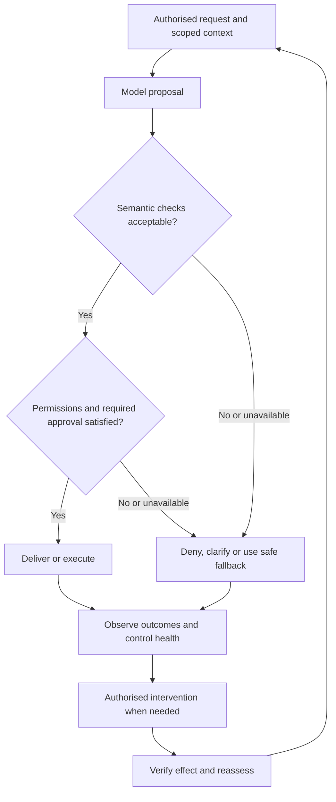

# When We Delegate Thinking

**Proposed subtitle:** How AI changes the way we build software—and the responsibilities of the software we build.

**Editorial draft 0.1 — 15 October 2026.** English confirmed by the author. Audience: delivery and engineering leaders, programme and project managers, product leaders, architects and practitioners responsible for enterprise AI. This document combines draft prose with chapter intent, evidence and proposed visuals. The chapter design and final wording remain open for author review.

Editorial owner: [personal site issue #2](https://github.com/oborskyivitalii/oborskyivitalii/issues/2). Existing execution route: [PR #79](https://github.com/oborskyivitalii/oborskyivitalii/pull/79). The earlier `site/publications/pmday-two-shifts/` manuscript and exports remain publisher test fixtures; this is the first real editorial draft based on the author's supplied arc. It is excluded from public output.

## Title alternatives

1. **When We Delegate Thinking** — reflective lead; use the subtitle to make the software focus explicit. Recommended working title.
2. **AI Changes Both Sides of Software Engineering** — the most direct continuation of the presentation, foregrounding HOW and WHAT.
3. **From Preserving Ideas to Delegating Judgment** — foregrounds the historical arc; needs a software-focused subtitle.
4. **Building Software When Judgment Becomes Part of the Product** — practical and specific, with less emphasis on the historical opening.

## Chapter list and argument

1. **Why this talk needed an article** — personal PMDay reflection and the question behind the presentation.
2. **From ideas that survive to judgments we delegate** — writing, print, computing and LLMs; scale and location of change.
3. **Two changes, two sets of consequences** — separate AI in software production from model judgment in the running product.
4. **How we build: faster production, a different delivery system** — flow, mixed evidence, comprehension, ownership and recovery.
5. **What we build: judgment becomes part of the product** — requirements for acceptable variation and preserved exact obligations.
6. **What counts as evidence that it is ready?** — coverage, uncertainty, severity and the distinction between completion and release.
7. **Control must work while the system is running** — authority, prevention, fallback, intervention and the cost of effective control.
8. **The delivery leader has to connect both changes** — changed dependencies, responsibilities and a practical first step.
9. **Delegating thought does not delegate responsibility** — return to the opening without claiming a settled historical forecast.

Planned finished-article length: approximately 3,000–3,800 words, subject to author review. Proposed visual set: four original explanatory figures and supporting tables; no decorative stock images, borrowed empirical charts or presentation screenshots are needed.

## 1. Why this talk needed an article

While preparing my PMDay presentation, I found myself building something that needed a second form. The slides could put the main contrasts in front of an audience, but they could not give every connection the space it deserved.

This article is that explanation. It follows the argument behind the talk, from a broad question about technological change to a practical one about software engineering: what happens when we begin to delegate work that involves interpretation and judgment?

We usually meet this question through tools. A coding assistant writes a function. An agent implements a change. A product answers a question or proposes an action. Each example is useful to examine, but together they suggest a change that reaches beyond any individual feature.

For people responsible for delivery, two parts of that change matter immediately. AI changes how we make software. It also changes what some of the software we make is responsible for doing. The presentation brought these two shifts together. The article gives us room to follow their consequences.

**Chapter intent and claims:** establish a personal reason for writing and the two-part thesis. Do not invent audience reactions, event anecdotes or a claim that the presentation settled the issue.

**Basis and visual:** author's supplied reflection; presentation slides 1–2 [1]. No opening illustration: the argument should lead.

## 2. From ideas that survive to judgments we delegate

Human societies change continuously, but changes differ in where they enter the system. Some improve a bounded activity. Others alter a capability used across institutions, occupations and generations. Their consequences travel much further than the original tool.

Writing is a useful historical comparison. It allowed a thought to remain available beyond the memory and presence of the person who expressed it. Much later, printing changed the scale, cost and reach of reproduction. An idea could travel beyond its immediate circle, survive its author and become material for people in another place or another century.

How many discoveries, political movements, conflicts or institutional changes became possible because ideas could persist and circulate in this way? There is no defensible single total. Historians and economists can investigate particular effects; that does not give us a complete counterfactual history of a world without writing or print. Dittmar's work on printing and city growth, and Rubin's work on printing and the Reformation, give concrete examples of effects studied well beyond the production of books [3–4].

Computers extended another capability: the execution of formal operations at scale. Large language models now expand the range of cognitive tasks we can ask a technical system to perform—interpreting a request, drafting an explanation, comparing alternatives or proposing a next step.

I use *delegating thinking* as shorthand for this practical delegation. It does not require a claim about consciousness or human-like understanding. Nor did delegation begin with LLMs: people, institutions and earlier computational systems have long carried out cognitive work on our behalf. The expansion in the range and accessibility of tasks is what matters here.

My expectation is that this shift will have consequences comparable in breadth to earlier changes in how ideas were preserved and used. That is an authorial expectation, not a measured historical equivalence or a timetable. Its eventual effects will depend on the systems, incentives and institutions into which we introduce it.

We can begin examining one of those systems now: software engineering.

**Chapter intent and claims:** connect the location of a change to the breadth of its possible effects. Preserve the author's historical argument while distinguishing analogy, documented historical findings and future expectation. Do not claim that writing and printing were one event, the only major prior shifts, or the sole causes of wars and scientific progress.

**Proposed Figure 1 — Capabilities that move beyond the individual.** Four equal panels: **writing: preserve and revisit**; **print: reproduce and circulate**; **computing: execute formal operations**; **LLMs: delegate selected interpretation and judgment**. Under each panel, show the changed possibility and a remaining human responsibility. This is a conceptual comparison, without a numerical progress axis, equal time intervals or an implication that each technology replaces the previous one. Caption: “Different technologies extend different capabilities. The comparison explains the argument; it does not measure their relative historical impact.” Original artwork; no historical images required.

## 3. Two changes, two sets of consequences

The first shift concerns production. AI participates in requirements work, design, implementation, testing, documentation and diagnosis. We need to understand whether that participation improves the whole delivery system, under which conditions, and at what cost.

The second shift concerns the product itself. Some systems now depend on model judgment to interpret a situation and produce a consequential response or action while they are running. We need to decide what behaviour is acceptable, how to evaluate it and how to retain effective control.

These shifts can occur independently. A team can use AI to build an ordinary application whose relevant runtime behaviour is governed by explicit rules. A team can also build a model-dependent product without using AI to write its code. Many teams will encounter both shifts together.

That distinction changes the questions we ask. Faster code production does not establish that a runtime model should receive more authority. A successful evaluation of the product does not establish that the delivery organisation can understand and maintain the code being generated.

**Chapter intent and claims:** give the reader a stable distinction used throughout the article. The dimensions are independent; an “AI-native” label cannot answer either set of questions.

**Proposed Figure 2 — Two independent dimensions of change.** Use this two-by-two matrix, with HOW as the horizontal axis and WHAT as the vertical axis. Examples are illustrative categories, not observed implementations.

| Runtime product | Conventional development | AI-assisted development |
| --- | --- | --- |
| Relevant behaviour uses explicit rules | Conventional application | AI helps build the application |
| Consequential responsibility depends partly on model judgment | Model-dependent product built conventionally | AI helps build a model-dependent product |

Caption: “How a system is built and what it depends on at runtime are separate questions.” Basis: slides 3 and 8 [1]. Conventional software is not assumed to be simple, certain or free of risk.

## 4. How we build: faster production, a different delivery system

Software delivery contains several kinds of work. Someone has to understand the need, shape a change, implement it, review it, verify it, integrate it and operate the result. Making one activity faster changes the balance between those activities.

Consider an intentionally simple example. A team can generate, review and integrate eight comparable changes a week. Generation capacity then rises to one hundred, while effective review and integration capacity remain at eight. If the team keeps admitting all those changes, the unfinished queue grows by ninety-two a week.

This is arithmetic under stated assumptions, not a forecast for every AI rollout. A team may limit intake, make changes smaller or improve review and testing with AI as well. Saved effort can also be valuable even when it does not increase releases. The point is that a gain at one stage creates a question about the whole flow; it does not answer that question.

### What the evidence can—and cannot—tell us

The presentation brings together research that measures different outcomes [2]. That variety matters. Activity, delivery performance, code structure and perceived usefulness are related, but they are not interchangeable.

| Source | Finding relevant to this article | Interpretation limit |
| --- | --- | --- |
| Demirer, Musolff and Yang, NBER, September 2026 revision [5] | The presentation's version-specific evidence register reports cumulative estimates across coding-tool generations of approximately 25.5× changed lines, 3.4× commits and 1.3× releases | Matched observational event study, not an RCT. Changed lines include additions and deletions. Different outcomes and tool-generation coverage; these multipliers are not a conversion funnel or a measurement of customer value |
| DORA 2025 [6] | Higher AI adoption is associated with higher delivery throughput and lower delivery stability | Survey-based association. Instability concerns change failures and deployment rework; it is not variation in model answers. This does not establish AI as the cause |
| METR, May 2026 survey [7] | Among 349 technical workers, median self-reported work-value uplift ranges from 1.4× to 2× across question formulations | Convenience sample and perceptions of a counterfactual. The range is not a confidence interval or measured delivery gain |
| GitClear 2026 public summary [8] | Reports declining reuse/refactoring-related signals and rising duplication and churn in its analysed changes | Commercial observational proxies. Moved lines are not a count of refactoring tasks. Separate report editions must not be treated as one comparable time series |
| Agarwal and colleagues, January 2026 v2 [9] | Finds increased repository-level cognitive complexity and some static-warning signals following coding-agent adoption | Matched repository analysis and static proxies, not technical debt per feature or a causal estimate for every team |

These findings support a more precise management question: where do useful local gains become sustained delivery gains, and where do additional review, coordination or maintenance demands appear? They do not establish one universal productivity multiplier.

### Understanding and recovery belong in the calculation

There is another capacity to consider: the team's ability to understand what it accepts. Generated code may pass checks while leaving unclear ownership, unfamiliar dependencies or weak knowledge of the decisions behind it. AI can also help explain and diagnose those things. Whether it closes the gap is something to demonstrate.

Imagine a business-critical component written in a language nobody on the team understands well. A working demo does not resolve the resulting review and recovery dependency. Someone still needs to explain the relevant behaviour, diagnose a failure and validate restoration.

The practical response is to test changes in the operating model: smaller batches, bounded work in progress, explicit ownership, useful living documentation, AI-assisted review alongside other checks, and recovery rehearsals. Observe lead time, review age, rework, release stability, incidents and team load together. These are candidate interventions to evaluate locally, rather than a universal recipe.

**Chapter intent and claims:** preserve real AI benefits while showing why generation volume alone is insufficient evidence of improved delivery. The comprehension gap is a hypothesis and engineering concern, not a biologically fixed ceiling established by the studies.

**Proposed Figure 3 — Capacity and the queue.** Two rows, “balanced example” and “generation accelerated only,” with generation / review / integration capacities of 8/8/8 and 100/8/8 changes per week. Show +92 waiting changes only in the second row. State the assumptions directly: comparable changes, unchanged downstream capacity, all candidates admitted, no discarded work and no WIP limit. Caption: “An illustrative queue, not measured team performance. Improving downstream capacity or limiting intake changes the result.” Avoid an unsupported exponential-generation versus linear-human-comprehension chart. Basis: slides 3–7 [1].

| Illustrative scenario | Generation capacity/week | Review capacity/week | Integration capacity/week | Queue growth/week under stated assumptions |
| --- | --- | --- | --- | --- |
| Balanced example | 8 | 8 | 8 | 0 |
| Generation accelerated only | 100 | 8 | 8 | 92 |

## 5. What we build: judgment becomes part of the product

The second shift starts when model judgment becomes part of how the running system fulfils a responsibility.

An access-recovery assistant illustrates the difference. It may need to interpret a person's description, retrieve relevant guidance, choose what to explain and decide when it lacks enough information. If a person acts on its answer, the answer can matter even when the assistant has no direct permission to change an account.

In Uncertainty Architecture, I use *Thinking System* for a system in which a consequential runtime responsibility depends partly on probabilistic model judgment [11]. The term identifies an engineering property. It does not claim consciousness, autonomy or adequate control.

Some variation is useful. Two answers can use different words and both satisfy the need. Other differences matter: an invented recovery step, disclosure of restricted information or an instruction outside the user's authority. Repeatedly producing the same answer does not establish that it is correct.

Requirements therefore need to describe acceptable behaviour across relevant situations. Which sources may be used? What information must be present? What must never be disclosed? When should the assistant ask a question, decline or refer the matter to someone else? What latency and operating cost are acceptable?

Exact obligations remain exact. Identity checks, permissions, schemas and transaction rules do not become approximate because a model is involved. A prompt may influence behaviour, but it does not by itself establish that those obligations are enforced.

**Chapter intent and claims:** explain a change in the object being engineered, without reducing all earlier software to a deterministic happy path. Use the access-recovery assistant throughout the WHAT half as an explicitly hypothetical example.

**Proposed treatment — Behaviour contract table, rather than another diagram.** Three rows: **acceptable variation** (different clear wording grounded in authorised guidance); **clarify or escalate** (insufficient or conflicting context); **prohibited outcome** (restricted disclosure, invented recovery steps, unauthorised changes). For each, name the requirement, example and verification approach. A conceptual “space of possibilities” drawing is optional only if the table proves insufficient; no probability contours or embedding-distance claims are proposed. Basis: slides 8–9 [1], UA requirements [11], NIST [10] and CheckList [12].

| Behaviour category | Example requirement | Illustrative case | Verification approach |
| --- | --- | --- | --- |
| Acceptable variation | Explain only authorised recovery steps clearly; preserve required warnings | Two differently worded answers give the same valid next steps | Domain-reviewed rubric, required-content checks and varied scenarios |
| Clarify or escalate | Do not invent missing account state or resolve a policy conflict without authority | Identity evidence is insufficient or guidance conflicts | Missing/conflicting-context tests; verify the clarification or escalation route |
| Prohibited outcome | Do not reveal restricted material or execute an unauthorised access change | Retrieved guidance includes a restricted credential or tool permissions are absent | Access and permission tests plus adversarial behavioural tests; a model-only judge is insufficient |

## 6. What counts as evidence that it is ready?

Once acceptable behaviour includes several valid answers, verification has to connect the intended responsibility to observable outcomes.

A curated set of scenarios helps test known requirements: ordinary requests, missing information, conflicting instructions, prohibited disclosures and difficult edge cases. A representative sample answers a different question: how often do defined outcomes occur under a specified usage distribution? Repeating one request many times cannot establish coverage of the situations people will encounter.

The evaluator also needs scrutiny. A domain expert, a rubric or another model can make mistakes. We need to know what was evaluated, by whom or by what, against which criteria, and using which version of the system.

The presentation uses a deliberately synthetic example [1–2]:

| Result in 200 illustrative evaluation units | Count | Why it matters |
| --- | --- | --- |
| Acceptable response | 196 | Useful aggregate information |
| Incorrect recovery instruction | 3 | A defined behavioural failure |
| Restricted information disclosed | 1 | A prohibited outcome that blocks this candidate's release under this example's agreed release rule |

The overall unacceptable share is 4/200, or 2%. Under the example's assumptions of independent, representative units and a stable target distribution, its 95% Wilson interval is approximately 0.8%–5.0% [13]. This is sampling uncertainty under those assumptions, not a guarantee about production.

More importantly, “98% acceptable” does not cancel a prohibited disclosure. Frequency, consequence and mandatory requirements have to be considered separately. Two hundred cases is a teaching choice, not a recommended universal sample size. A curated “Golden Set” of known cases cannot automatically be used to estimate a production failure rate.

This leads to three distinct delivery questions. Are we ready to undertake the work with sufficiently understood requirements, dependencies and evaluation plans? Has the candidate met its agreed quality and evidence commitments? Is its release into a specified scope authorised, with its remaining risks and operating arrangements understood?

Evidence supports those decisions. It does not make all three decisions automatically.

**Chapter intent and claims:** distinguish test coverage, rate estimation, severity and authority. Extend existing engineering disciplines; do not imply that all testing becomes statistical, that Scrum was previously non-empirical, or that a Sprint Review is a mandatory release gate.

**Visual treatment:** retain the severity table above rather than add a green 98% pie chart. Add a compact “Ready / Done / Release” comparison table in the finished article if needed. Basis: slides 10–11 [1–2], NIST [10], CheckList [12] and Wilson method [13].

## 7. Control must work while the system is running

Pre-release evidence describes what we have examined. Operating control determines what can happen when the system encounters a real situation, when a dependency changes or when a required check is unavailable.

For the assistant, this starts before an answer is delivered. Access restrictions must apply to retrieval and context construction. A semantic check can look for an unsupported step, but it is fallible. Permissions and required approvals have to constrain what may be disclosed or executed. When required conditions fail, the system needs an available denial, clarification or fallback path.

After delivery, the organisation needs evidence about outcomes and about the health of those controls. Someone with the appropriate authority must be able to intervene: narrow a task, disable a tool, stop a path, change a configuration or suspend the service. The effect of that intervention must be verified.

A dashboard alone does not provide this capability. Nor does the phrase “human in the loop.” The person needs relevant evidence, competence, decision rights and enough time and capacity to act before the consequence being controlled. Some consequences, including disclosure, cannot be undone by a later rollback.

The required controls depend on consequence, authority and reversibility. An assistant drafting guidance for qualified review and an agent changing access autonomously need different designs. Control also consumes latency, engineering effort, monitoring capacity, reviewer time and money. Those costs belong in the feasibility decision.

If effective control cannot be provided within the required window and budget, narrowing the responsibility, redesigning the workflow or rejecting that use of AI remains an engineering outcome.

**Chapter intent and claims:** connect authority and evidence to actual prevention and correction. The illustration below is one explanatory architecture, not a prescribed topology or a correctness guarantee. NIST provides lifecycle guidance [10]; the specific control vocabulary and arrangement are the author's UA synthesis [11].

**Proposed Figure 4 — Before consequence and after consequence.** Original two-part control diagram. Read it with pre-retrieval access boundaries applying from the start; a failed or unavailable required check cannot take an allowed-action branch.

Caption: “A schematic control path. Semantic checking can fail; permissions constrain authority. Delivered, denied and fallback outcomes all need observation. Intervention changes future operation but cannot necessarily reverse an earlier consequence.” Alternative visual composition: two adjoining panels rather than one large loop, if required for mobile readability. Basis: slide 12 [1] and UA control/lifecycle sources [11].

## 8. The delivery leader has to connect both changes

These two shifts meet in the delivery plan. A team may be generating changes faster while also taking on work that requires new evaluation, domain review and operational response. Planning only for implementation capacity misses both sides of that change.

The responsibilities can be held by existing people. Product and domain owners explain useful outcomes, unacceptable consequences and priorities. Engineering establishes architecture, permissions, maintainability and recovery. Quality work connects requirements to evaluation and examines its limitations. A designated release or risk authority decides within its remit. Operations must be able to recognise and respond to the conditions the design assumes.

For a delivery or programme leader, the task is to make those dependencies visible and executable: named owners, sufficient capacity, time for evidence work, decisions at the right point and a closure condition that can be demonstrated. That role does not automatically inherit every architectural or risk decision.

| Delivery question | HOW: AI in production | WHAT: model judgment in the product |
| --- | --- | --- |
| What capacity is needed? | Review, integration, understanding and recovery | Domain evaluation, monitoring and response |
| What evidence matters? | Accepted changes, lead time, rework, stability and ownership | Behavioural coverage, consequences, uncertainty and control effectiveness |
| What can invalidate the plan? | Growing queues, unfamiliar critical code, weak repair capability | Changed context or dependencies, missing authority, ineffective controls, insufficient response capacity |
| What decision may follow? | Adjust intake, batches, tooling, ownership or team capability | Narrow scope, reevaluate, change controls, suspend or decline the use case |

My practical starting point is one bounded workflow. State the useful outcome, the authority delegated, the prohibited outcomes, the evidence required and the people who will act when limits are reached. Test it with operating controls and a rehearsed fallback. Compare the result with a credible baseline, including quality, operating cost and human effort.

Then decide whether to expand, change or stop. A pilot should resolve an uncertainty that matters to the next decision. It should not become a ceremonial step on the way to an already promised rollout.

**Chapter intent and claims:** translate the talk into work for the usual audience, without prescribing a new department or committee. Treat the interventions as practical proposals. Basis: slides 13–14 [1]; source guidance [10] does not prescribe these job titles.

**Visual treatment:** the paired responsibility table above. No additional flow diagram: Figure 4 already carries the evidence-and-intervention loop.

## 9. Delegating thought does not delegate responsibility

Writing gave ideas a life beyond the person who expressed them. Printing expanded their circulation. Computation expanded what formal operations could be executed. We are now extending the cognitive work that technical systems can perform on our behalf.

The historical consequences will take time to unfold. We do not need a complete forecast to recognise the immediate engineering questions.

When AI participates in building software, we need to understand the resulting delivery system. When model judgment participates in the product's responsibilities, we need to understand the resulting product and its control. In both cases, a demonstration of capability is the beginning of a decision about its use.

That is the connection I wanted to make at PMDay, and the reason for writing it out here. We can delegate more work. We still have to decide what we are delegating, on what evidence, within which authority, and with what ability to respond when the result is unacceptable.

**Chapter intent and visual:** close the personal reflection and connect the two lenses. No new diagram or empirical claim. Link the presentation/recording and the two research repositories after the conclusion.

## Sources and further reading

The presentation is the article's structural source. Empirical studies support bounded findings, historical papers support particular historical mechanisms, and UA supplies the author's engineering vocabulary and synthesis. None independently proves the proposed scale of future social change. Links and selected versions were checked for this draft on 15 October 2026; the NBER full PDF was not newly retrieved successfully in this session, so its precise September figures retain the talk's existing version-specific evidence reconciliation.

1. **Vitalii Oborskyi — PMDay 2026 presentation, current v35, 15 slides.** [Editable presentation and current slide source](https://github.com/UncertaintyArchitectureGroup/uncertainty-architecture/blob/22639d311d5fb46a23f3d5cdd819800dbe1169d9/assets/presentations/pmday-2026/README.md). Current working explanatory source remains a reviewed draft candidate, not an accepted published deck edition. Its exact equivalence to the edition delivered at the event has not been established in this draft. [Talk recording — Ukrainian](https://youtu.be/xSgWjuGqC9I).
2. **PMDay evidence base and limitations.** [Pinned evidence register](https://github.com/UncertaintyArchitectureGroup/uncertainty-architecture/blob/22639d311d5fb46a23f3d5cdd819800dbe1169d9/assets/presentations/pmday-2026/EVIDENCE.md). Includes precise editions, study designs, units and corrections behind the slides.
3. **Jeremiah E. Dittmar (2011), Information Technology and Economic Change: The Impact of the Printing Press.** [Journal article](https://doi.org/10.1093/qje/qjr035) · [Author's accessible explanation](https://cepr.org/voxeu/columns/information-technology-and-economic-change-impact-printing-press). Particular urban/economic effects, not a total accounting of print's historical consequences.
4. **Jared Rubin (2014), Printing and Protestants: An Empirical Test of the Role of Printing in the Reformation.** [University repository and paper](https://digitalcommons.chapman.edu/economics_articles/99/). Particular religious diffusion mechanism; not technological monocausality.
5. **Mert Demirer, Leon Musolff and Liyuan Yang (2026), Writing Code vs. Shipping Code: Productivity Effects Across Generations of AI Coding Tools.** [NBER Working Paper 35275](https://www.nber.org/papers/w35275). Use the September 2026 revision selected in the presentation; future revisions must be checked separately.
6. **DORA (2025), State of AI-assisted Software Development.** [Official report and errata](https://dora.dev/research/2025/dora-report/) · [Official findings summary](https://cloud.google.com/blog/products/ai-machine-learning/announcing-the-2025-dora-report). The presentation uses v2025.2; survey associations and respondent shares must retain their units.
7. **METR (11 May 2026), Measuring the Self-Reported Impact of Early-2026 AI on Technical Worker Productivity.** [Study and methodology](https://metr.org/blog/2026-05-11-ai-usage-survey/). Self-reported perceived uplift, distinct from METR's earlier coding RCT and later experiment-design update.
8. **GitClear (2026), The Maintainability Gap: AI Code Quality in 2026.** [Public report summary](https://www.gitclear.com/the_ai_code_quality_maintainability_gap). Public summary inspected; full gated whitepaper not newly audited. Avoid cross-edition arithmetic and conflicting absolute duplication units.
9. **Agarwal and colleagues (2026), AI IDEs or Autonomous Agents? Measuring the Impact of Coding Agents on Software Development.** [January v2 paper](https://arxiv.org/html/2601.13597v2). Repository-level matched analysis, with static proxies and cohort limitations.
10. **NIST, AI Risk Management Framework 1.0 (2023) and Generative AI Profile (2024).** [AI RMF](https://nvlpubs.nist.gov/nistpubs/ai/NIST.AI.100-1.pdf) · [Generative AI Profile](https://nvlpubs.nist.gov/nistpubs/ai/NIST.AI.600-1.pdf) · [Accessible RMF Core](https://airc.nist.gov/airmf-resources/airmf/5-sec-core/). Lifecycle and risk-management guidance, not a universal numerical acceptance threshold or a prescribed staffing model.
11. **Uncertainty Architecture — author's conceptual sources.** [Controlled-object definition](https://github.com/UncertaintyArchitectureGroup/uncertainty-architecture/blob/22639d311d5fb46a23f3d5cdd819800dbe1169d9/00-doctrine/uncertainty-in-the-controlled-object.md) · [Requirements, correctness and bugs](https://github.com/UncertaintyArchitectureGroup/uncertainty-architecture/blob/22639d311d5fb46a23f3d5cdd819800dbe1169d9/00-doctrine/requirements-correctness-and-bugs.md) · [Control-loop anatomy](https://github.com/UncertaintyArchitectureGroup/uncertainty-architecture/blob/22639d311d5fb46a23f3d5cdd819800dbe1169d9/00-doctrine/control-loop-anatomy.md) · [Nested control lifecycle](https://github.com/UncertaintyArchitectureGroup/uncertainty-architecture/blob/22639d311d5fb46a23f3d5cdd819800dbe1169d9/00-doctrine/nested-control-lifecycle.md).
12. **Marco Tulio Ribeiro, Tongshuang Wu, Carlos Guestrin and Sameer Singh (2020), Beyond Accuracy: Behavioral Testing of NLP Models with CheckList.** [ACL paper](https://aclanthology.org/2020.acl-main.442/). Behavioural test design; not a universal standard for every model-dependent system.
13. **NIST Engineering Statistics Handbook — confidence intervals for a proportion.** [Wilson score method](https://www.itl.nist.gov/div898/handbook/prc/section2/prc241.htm). Used only for the explicitly synthetic 4/200 example.
14. **The Subprime Code Crisis.** [Canonical research repository](https://github.com/UncertaintyArchitectureGroup/The-Subprime-Code-Crisis). Further reading on the delivery-risk synthesis; original studies above remain the evidence owners. [Uncertainty Architecture repository](https://github.com/UncertaintyArchitectureGroup/uncertainty-architecture) owns its framework and research status.
