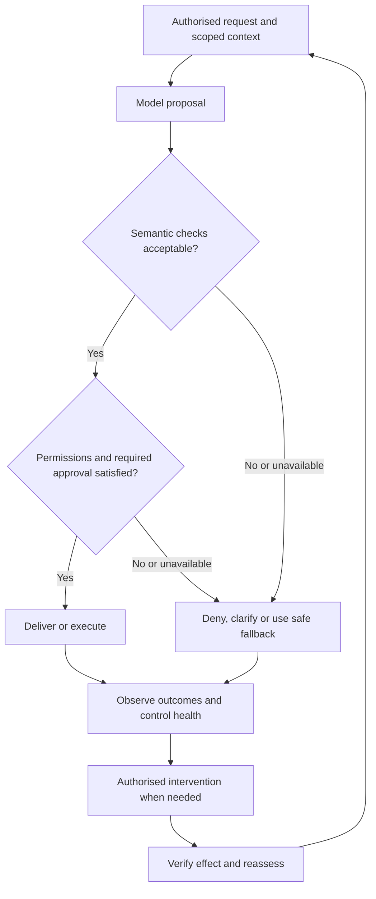

# AI Changes Both Sides of Software Engineering

**Proposed subtitle:** How AI changes the way we build software—and the responsibilities of the software we build.

**Editorial draft 0.3 — 15 October 2026.** Title selected by the author. English confirmed by the author. Audience: delivery and engineering leaders, programme and project managers, product leaders, architects and practitioners responsible for enterprise AI. This document combines draft prose with chapter intent, evidence and proposed visuals. The chapter design and final wording remain open for author review.

Editorial owner: [personal site issue #2](https://github.com/oborskyivitalii/oborskyivitalii/issues/2). Existing execution route: [PR #79](https://github.com/oborskyivitalii/oborskyivitalii/pull/79). The earlier `site/publications/pmday-two-shifts/` manuscript and exports remain publisher test fixtures; this is the evolving real editorial draft based on the author's supplied arc. It is excluded from public output.

## Chapter list and argument

1. **Why this talk needed an article** — PMDay reflection and the question behind the presentation.
2. **From ideas that survive to judgments we delegate** — writing, print, computing and LLMs; the scale and location of change.
3. **Two changes, two sets of consequences** — HOW we produce software and WHAT responsibilities the running product takes on.
4. **How we build: the bottleneck did not appear by itself** — uneven acceleration, vendor narratives, Anthropic's Scion case and delivery evidence.
5. **Promising ways forward—and the incident they must survive** — AI review, documentation, SDD, replaceable code, ownership and demonstrated recovery.
6. **Faster delivery to what end?** — selection, learning, stability, user attention and realised value.
7. **What we build: judgment becomes part of the product** — acceptable variation and preserved exact obligations.
8. **What counts as evidence that it is ready?** — coverage, uncertainty, severity and release authority.
9. **Control must work while the system is running** — prevention, fallback, intervention and full operating cost.
10. **The delivery leader has to connect both changes** — owners, capacity, customer outcomes and an evidence-led first step.
11. **Delegating thought does not delegate responsibility** — a promising future, with a plan for when its assumptions fail.

This expanded working draft retains chapter notes and evidence boundaries for review. The site edition uses descriptive source hyperlinks within the prose, with a source list at the end; other platform adaptations remain a later editorial task. Proposed visual set: five original explanatory figures plus supporting tables; no decorative stock images, borrowed empirical charts or presentation screenshots. Final length and visual selection remain editorial decisions.

## 1. Why this talk needed an article

While preparing my [PMDay presentation](https://github.com/UncertaintyArchitectureGroup/uncertainty-architecture/blob/22639d311d5fb46a23f3d5cdd819800dbe1169d9/assets/presentations/pmday-2026/README.md), I found myself building something that needed a second form. The slides could put the main contrasts in front of an audience, but they could not give every connection the space it deserved.

This article is that explanation. It follows the argument behind the talk, from a broad question about technological change to a practical one about software engineering: what happens when we begin to delegate work that involves interpretation and judgment?

We usually meet this question through tools. A coding assistant writes a function. An agent implements a change. A product answers a question or proposes an action. Each example is useful to examine, but together they suggest a change that reaches beyond any individual feature.

For people responsible for delivery, two parts of that change matter immediately. AI changes how we make software. It also changes what some of the software we make is responsible for doing. The presentation brought these two shifts together. The article gives us room to follow their consequences.

**Chapter intent and claims:** establish a personal reason for writing and the two-part thesis. Do not invent audience reactions, event anecdotes or a claim that the presentation settled the issue.

**Basis and visual:** author's supplied reflection; presentation [slides 1–2](https://github.com/UncertaintyArchitectureGroup/uncertainty-architecture/blob/22639d311d5fb46a23f3d5cdd819800dbe1169d9/assets/presentations/pmday-2026/README.md). No opening illustration: the argument should lead.

## 2. From ideas that survive to judgments we delegate

Human societies change continuously, but changes differ in where they enter the system. Some improve a bounded activity. Others alter a capability used across institutions, occupations and generations. Their consequences travel much further than the original tool.

Writing is a useful historical comparison. It allowed a thought to remain available beyond the memory and presence of the person who expressed it. Much later, printing changed the scale, cost and reach of reproduction. An idea could travel beyond its immediate circle, survive its author and become material for people in another place or another century.

How many discoveries, political movements, conflicts or institutional changes became possible because ideas could persist and circulate in this way? There is no defensible single total. Historians and economists can investigate particular effects; that does not give us a complete counterfactual history of a world without writing or print. [Dittmar's work on printing and city growth](https://doi.org/10.1093/qje/qjr035), and [Rubin's work on printing and the Reformation](https://digitalcommons.chapman.edu/economics_articles/99/), give concrete examples of effects studied well beyond the production of books.

Computers extended another capability: the execution of formal operations at scale. Large language models now expand the range of cognitive tasks we can ask a technical system to perform—interpreting a request, drafting an explanation, comparing alternatives or proposing a next step.

I use *delegating thinking* as shorthand for this practical delegation. It does not require a claim about consciousness or human-like understanding. Nor did delegation begin with LLMs: people, institutions and earlier computational systems have long carried out cognitive work on our behalf. The expansion in the range and accessibility of tasks is what matters here.

My expectation is that this shift will have consequences comparable in breadth to earlier changes in how ideas were preserved and used. That is an authorial expectation, not a measured historical equivalence or a timetable. Its eventual effects will depend on the systems, incentives and institutions into which we introduce it.

We can begin examining one of those systems now: software engineering.

**Chapter intent and claims:** connect the location of a change to the breadth of its possible effects. Preserve the author's historical argument while distinguishing analogy, documented historical findings and future expectation. Do not claim that writing and printing were one event, the only major prior shifts, or the sole causes of wars and scientific progress.

**Proposed Figure 1 — Capabilities that move beyond the individual.** Four equal panels: **writing: preserve and revisit**; **print: reproduce and circulate**; **computing: execute formal operations**; **LLMs: delegate selected interpretation and judgment**. Under each panel, show the changed possibility and a remaining human responsibility. This is a conceptual comparison, without a numerical progress axis, equal time intervals or an implication that each technology replaces the previous one. Caption: “Different technologies extend different capabilities. The comparison explains the argument; it does not measure their relative historical impact.” Original artwork; no historical images required.

## 3. Two changes, two sets of consequences

The first shift concerns production. AI participates in requirements work, design, implementation, testing, documentation and diagnosis. We need to understand whether that participation improves the whole delivery system, under which conditions, and at what cost.

The second shift concerns the product itself. Some systems now depend on model judgment to interpret a situation and produce a consequential response or action while they are running. We need to decide what behaviour is acceptable, how to evaluate it and how to retain effective control.

These shifts can occur independently. A team can use AI to build an ordinary application whose relevant runtime behaviour is governed by explicit rules. A team can also build a model-dependent product without using AI to write its code. Many teams will encounter both shifts together.

That distinction changes the questions we ask. Faster code production does not establish that a runtime model should receive more authority. A successful evaluation of the product does not establish that the delivery organisation can understand and maintain the code being generated.

**Chapter intent and claims:** give the reader a stable distinction used throughout the article. The dimensions are independent; an “AI-native” label cannot answer either set of questions.

**Proposed Figure 2 — Two independent dimensions of change.** Use this two-by-two matrix, with HOW as the horizontal axis and WHAT as the vertical axis. Examples are illustrative categories, not observed implementations.

| Runtime product | Conventional development | AI-assisted development |
| --- | --- | --- |
| Relevant behaviour uses explicit rules | Conventional application | AI helps build the application |
| Consequential responsibility depends partly on model judgment | Model-dependent product built conventionally | AI helps build a model-dependent product |

Caption: “How a system is built and what it depends on at runtime are separate questions.” Basis: [slides 3 and 8](https://github.com/UncertaintyArchitectureGroup/uncertainty-architecture/blob/22639d311d5fb46a23f3d5cdd819800dbe1169d9/assets/presentations/pmday-2026/README.md). Conventional software is not assumed to be simple, certain or free of risk.

## 4. How we build: the bottleneck did not appear by itself

Software delivery is a system of connected activities. Understanding a need, choosing an approach, writing code, reviewing it, verifying it, integrating it and operating the result all consume capacity. Accelerating one activity changes the balance between them.

Consider a deliberately simple example. A team can generate, review and integrate eight comparable changes a week. Generation capacity rises to one hundred; review and integration remain at eight. If all generated changes enter the queue, unfinished work grows by ninety-two a week.

Nothing mysterious happened to review. We changed the rate at which work arrived.

The real situation can be more demanding: larger changes, unfamiliar components and additional dependencies can increase the effort needed to assess each change. AI can also make review, testing and diagnosis faster. The question is whether the whole system has been rebalanced, including the quality of its decisions and its ability to recover.

**Proposed Figure 3 — Local acceleration and the resulting queue.** Use this small table or two aligned capacity diagrams. All numbers are synthetic, in comparable changes per week. Queue growth assumes every generated change is admitted, with unchanged downstream capacity and no discarded work. This is not a prediction of AI productivity.

| Scenario | Generation capacity | Review capacity | Integration capacity | Queue growth per week |
| --- | --- | --- | --- | --- |
| Balanced example | 8 | 8 | 8 | 0 |
| Generation accelerated only | 100 | 8 | 8 | 92 |

### The vendor narrative contains a real observation

[Anthropic's March 2026 Code Review announcement](https://claude.com/resources/articles/code-review) explicitly identifies review as a bottleneck after code output increased. Its response is agent-assisted review; humans still approve PRs. Microsoft's Jay Parikh makes the direction unusually clear in his [June post](https://commandline.microsoft.com/new-rules-for-builders-agentic-ai-development-jay-parikh-build-2026/), with headings including “Don’t let code review become a bottleneck” and “Code is disposable”.

These are useful examples of the narrative, but its strongest version deserves care. Review and comprehension were already part of the work. Increasing code production without matching downstream capability can expose or intensify a constraint; it does not make the constrained activity unnecessary. Nor does every queue prove careless adoption: ordinary growth, complexity and pre-existing organisational problems can contribute.

If we have accelerated generation without considering the rest, the resulting imbalance is partly a consequence of our delivery design. Calling people the bottleneck does not settle whether to automate their work, improve it, add capacity, reduce incoming work or retain a necessary limit.

Vendors also recognise this. [Anthropic's August SDLC playbook](https://claude.com/resources/articles/the-ai-native-sdlc-playbook) explicitly calls for lifecycle-wide changes, preserving control objectives through different enforcement. The important disagreement is therefore about which replacements have demonstrated the required outcomes, in which environments, and with what remaining failure modes.

### Review also builds the people who will own the system

Code review has more than one output. It can identify a defect before release. It can also help another engineer understand what changed, why it changed, which assumptions it relies on and how it interacts with the rest of the system. The conversation can spread knowledge beyond the person who wrote the code and give the team a chance to challenge the design.

This broader role predates AI coding tools. In their [study of modern code review](https://www.microsoft.com/en-us/research/publication/expectations-outcomes-and-challenges-of-modern-code-review/), Alberto Bacchelli and Christian Bird found knowledge transfer and increased team awareness alongside defect detection. Understanding the code and the change was central to the review process. The study examined Microsoft teams; it does not establish that every review produces these benefits.

That makes review one mechanism for building ownership. In that sense, it can function as an ownership gate as well as a quality gate. A useful review helps turn a change produced by one contributor into a system that other people can explain, maintain and operate. This understanding gives the team's acceptance practical substance: people have a basis for judging the consequences of the change and responding when something goes wrong.

Formal responsibility may already sit with the team whether it understands the system or not. Removing understanding does not remove that responsibility; it can leave the team responsible for outcomes it is less capable of controlling. Understanding is therefore part of the capacity to act responsibly, together with authority, evidence, tools and time.

If we automate review, we need to ask what happens to both outputs. An automated reviewer may improve defect detection without transferring the same knowledge to the people on call. A human approval can also become ceremonial and achieve neither. The question is how the new workflow demonstrates both adequate inspection and sufficient shared understanding for the responsibilities the team retains.

### What Anthropic's latest repository redesign actually shows

On 13 October 2026, Anthropic [described Scion](https://www.anthropic.com/engineering/redesigning-source-control), its internal source-control system, alongside its Antique review tool. The company reports growth from roughly 2,500 daily merges in May to over 30,000 in September, and checkouts about two orders of magnitude faster than before.

That is a substantial reported infrastructure result. It is not evidence that customer value or end-to-end delivery became one hundred times greater. Anthropic describes an unusual workload and says Git remains appropriate for most repositories.

Its account also retains a significant human role: engineers supply architectural understanding, reject unsuitable agent decisions and review every change for intent. The team reports extensive simulation, fuzzing and access controls.

This case illustrates both the pressure created by increased production and a serious attempt to rebalance the supporting system. Copying the reduced emphasis on line-by-line review without examining the accompanying expertise and controls would be a different experiment.

### Delivery evidence measures several different things

The studies in the [presentation's evidence register](https://github.com/UncertaintyArchitectureGroup/uncertainty-architecture/blob/22639d311d5fb46a23f3d5cdd819800dbe1169d9/assets/presentations/pmday-2026/EVIDENCE.md) help resist the temptation to call every increase “productivity”.

| Source | Relevant finding | What it does not establish |
| --- | --- | --- |
| [Demirer, Musolff and Yang, NBER, September 2026 revision](https://www.nber.org/papers/w35275) | The presentation's version-specific register reports cumulative estimates across tool generations of approximately 25.5× changed lines, 3.4× commits and 1.3× releases | These observational estimates concern different outcomes and generation coverage. Changed lines include additions and deletions; this is not a conversion funnel or 25.5× more useful features |
| [DORA 2025](https://dora.dev/research/2025/dora-report/) | Higher AI adoption is associated with higher delivery throughput and lower stability | Survey association is not causation; stability concerns change failures and deployment rework |
| [METR, May 2026](https://metr.org/blog/2026-05-11-ai-usage-survey/) | 349 technical workers report median work-value uplift of 1.4×–2× across question formulations | Perceived counterfactual value in a convenience sample, not a measured delivery multiplier or confidence interval |
| [GitClear 2026 public summary](https://www.gitclear.com/the_ai_code_quality_maintainability_gap) | Declining reuse/refactoring-related signals and rising duplication and churn | Observational code-change proxies, not direct counts of refactoring tasks or a harmonised cross-edition trend |
| [Agarwal and colleagues, January 2026 v2](https://arxiv.org/html/2601.13597v2) | Increased repository-level cognitive complexity and some static-warning signals following agent adoption | Matched static proxies, not debt per feature or a universal causal effect |

These findings do not yield one universal verdict on AI-assisted development. They give us reasons to measure the complete workflow: useful outcomes, lead time, rework, stability, comprehension, operating cost and recovery.

**Chapter intent and evidence:** replace the vague claim that humans suddenly became an obstacle with an explicit flow argument. Separate vendor observation, vendor prescription, observational research and the synthetic queue example. The Scion case is a reported success with stated conditions, not an allegation that Anthropic abandoned engineering control.

## 5. Promising ways forward—and the incident they must survive

There are plausible ways to handle the new balance. AI review can broaden inspection. Generated documentation can help people navigate unfamiliar systems. Spec-driven development can make intent, constraints and acceptance criteria more explicit. Cheap regeneration can make some implementations easier to replace.

We should examine these approaches seriously. Their potential is part of the argument.

[GitHub's Spec Kit](https://github.blog/ai-and-ml/generative-ai/spec-driven-development-with-ai-get-started-with-a-new-open-source-toolkit/) puts specifications at the centre of an agent workflow, while explicitly requiring people to verify generated artifacts and review focused changes. [Cognition presents DeepWiki](https://cognition.com/blog/deepwiki) as a way to help developers understand complex repositories. [Microsoft's disposable-code proposal](https://commandline.microsoft.com/new-rules-for-builders-agentic-ai-development-jay-parikh-build-2026/) describes bounded features whose specifications might outlive their implementations; the same post retains human architectural oversight and stresses product judgment.

None of those statements amounts to a general instruction to stop understanding systems. The risky inference is the next one: because these tools exist, the organisation can safely reduce its ability to understand, challenge and repair what they produce.

That is a stronger claim than the examples establish.

### Generated documentation moves the trust question

Automatically generated documentation is a promising direction. A good explanation can make an unfamiliar system easier to navigate, expose its structure and help engineers ask better questions. We should try to capture those benefits.

But there is a paradox in using it as the answer to the comprehension bottleneck. We say that people cannot keep up with reviewing generated code. Part of that review was needed to understand the system and establish confidence in what it would do. We then ask an LLM to produce an explanation of the code and propose that people rely on the explanation instead.

The explanation may be easier to read. What establishes that it is faithful?

If the code needs verification, an LLM-generated description of that code does not become trustworthy merely by being written in prose. It may omit an exception, describe intended rather than actual behaviour, or repeat the same mistaken assumption as the implementation. Agreement between generated code and generated documentation can reflect a shared error.

We have moved the understanding problem to another representation. We may have made it cheaper to solve, but we have not automatically solved it. To rely on the documentation, we still need evidence connecting its claims to the relevant code and the system's actual behaviour. Even a perfectly accurate description of the code does not establish that the code meets the requirement.

This does not mean every reader must manually compare every sentence with every line. Useful approaches include links to the exact implementation version, executable examples, traces from representative scenarios, tests grounded in independently established requirements, and focused checks of consequential claims. A different model can help challenge an explanation; it does not by itself make the evidence independent.

The practical test is whether engineers can use the documentation to predict behaviour, explain important constraints and diagnose an unfamiliar failure—and whether those answers survive verification. Reading time alone is an incomplete measure of success.

Generated documentation can become part of how a team earns understanding. Its existence is not evidence that the team already has it.

### A specification is an asset; its adequacy is still a question

Specifications, documentation, testing and replaceable components have substantial engineering histories. It would be wrong to describe all of them as untested ideas. What remains a hypothesis in a particular organisation is that a new combination of agents and artifacts can replace a particular human control while preserving the outcomes that control was supposed to protect.

A specification can be internally consistent while omitting a critical exception. Code and tests generated from the same mistaken assumption can agree with each other. A fresh implementation can pass its suite while mishandling existing data or an integration the specification never captured.

These are possible failure modes, not findings that every such workflow fails. They tell us what a credible evaluation should include.

| Proposed approach | Potential benefit | What the team still needs to demonstrate |
| --- | --- | --- |
| AI-assisted review | Broader inspection and faster feedback | Defects and architectural violations are found; the workflow also develops enough shared understanding for maintenance and incident response |
| Generated documentation | Faster navigation and explanation | Consequential claims are checked against the relevant implementation and observed behaviour; engineers can use the explanation to investigate failures, and missing rationale remains visible |
| Spec-driven development | Clearer intent and constraints; traceable changes | The specification is adequate, conflicts are resolved, and implementation is checked against evidence beyond its own generated narrative |
| Replaceable or regenerated code | Cheaper correction and experimentation | Behaviour, data, integrations and rollback remain controlled; replacement can be verified within the required recovery window |

### Understanding does not mean memorising every line

Engineers have always relied on abstractions, libraries, tools and other people. Effective ownership does not require one person to hold an entire system in their head.

It does require a credible ability to answer consequential questions: what is running, what assumptions it depends on, what it is allowed to do, how a failure can spread, and how to establish that a repair worked. Some of the knowledge supporting this understanding can be recorded in executable checks, reliable documentation and tooling. The team still has to be able to use and challenge that evidence. Producing more explanatory artifacts is not the same as developing that capability.

Changing the level at which people review work can be a good engineering decision. Losing the ability to investigate when the abstraction fails is a different outcome.

### Begin with the production incident

Imagine that a critical workflow stops working after several weeks of rapid AI-assisted delivery. Customers cannot complete transactions. The generated explanations sound plausible, but successive fixes do not restore the service. Nobody can confidently identify the violated invariant, and the team is unsure whether a proposed rewrite will damage existing data.

This is a hypothetical incident, not a prediction. It is also a legitimate design scenario for a delivery model.

Who can contain the impact? Can the team restore a known-good artifact? What happens if a data migration makes a simple rollback unsafe? Can engineers diagnose the problem if the coding service is unavailable or continues proposing ineffective fixes? Who verifies recovery, and within what time?

An AI coding tool does not, merely by being adopted, become the operator responsible for restoring your service. A claim of faster development does not establish that its provider will absorb your organisation's incident losses. Whatever support or contractual arrangements exist, your operating plan still needs an answer for customers, disrupted business and damaged trust.

This is why “what if it does not work?” belongs in the adoption decision, before expertise is removed or an unfamiliar critical system accumulates beyond the team's recovery capability.

The answer can include AI. It may diagnose the incident faster than a person, suggest a safer repair or help expand recovery tests. We should measure that benefit too. But a plan that works only while the same assistant keeps succeeding has left an important dependency unexamined.

A bounded trial can test both normal delivery and recovery: inject a representative failure, provide realistic access and time limits, observe diagnosis and restoration, and verify the result. Compare with the existing approach. Expand when the evidence supports expansion; narrow or stop when it does not.

**Chapter intent and evidence:** make the author's concern about ownership operational rather than equating it with mandatory manual review of every line. The linked vendor sources establish proposed practices and reported experience, not general guarantees. The failure scenarios and suggested trial are the author's engineering analysis. This section makes no universal claim about vendors' legal liability.

**Visual treatment:** retain the four-row benefit/evidence table. No catastrophe illustration or “humans versus AI” image; the concrete incident carries the argument.

## 6. Faster delivery to what end?

Even a well-balanced delivery system can optimise the wrong outcome.

The [NBER comparison](https://www.nber.org/papers/w35275) is useful here because changed lines, commits and releases are different measurements. We should not turn its largest multiplier into an ambition to expose customers to the same multiple of new features. The study does not measure that result, and feature volume would still not tell us whether customers benefited.

Suppose, separately, that a product organisation really could take twenty-five times as many ideas to users. This is a thought experiment, not an estimate from the report. Would it necessarily become a better product organisation?

In a slower delivery system, an idea may have to survive conversations with business stakeholders, engineers, infrastructure teams and operations. Those discussions can reveal weak demand, contradictory requirements, disproportionate operating costs or a problem better solved without a new feature. Some ideas disappear before implementation.

When implementation becomes cheap, it becomes easier to bypass that challenge and build first. If the organisation also weakens selection, more unexamined ideas can reach customers.

But slow delivery is not a dependable quality filter. Good ideas also die in queues. Some discussions add little beyond delay, and some assumptions are easier to test with a cheap prototype than with another meeting. The goal is to preserve the useful challenge and evidence while removing avoidable waiting.

[Microsoft's research on online experimentation](https://www.microsoft.com/en-us/research/publication/online-experimentation-at-microsoft/) offers a concrete reason to do this: controlled tests can challenge confident advance judgments about which features will help customers. More experiments can create value through better decisions, including the decision not to ship broadly. More launches alone do not demonstrate that learning.

### The person using the software has a capacity too

For products people use directly, learning and adaptation do not disappear when implementation accelerates. Customers still have goals, limited attention, established workflows and varying willingness to change them.

Suppose every proposed feature is useful in isolation. A user may still need to discover it, decide when it matters, learn a changed interaction or coordinate a new process with colleagues. Those demands accumulate. A release can be technically successful while making the product harder to use.

The classic [feature-fatigue research by Thompson, Hamilton and Rust](https://doi.org/10.1509/jmkr.2005.42.4.431) found that people can favour capability before use but place greater weight on usability after using a product. It supports a bounded point: attractive additional capabilities do not automatically increase experienced satisfaction. It does not establish a universal limit on release frequency or a fixed speed of human adaptation.

The practical question is therefore not whether people can consume twenty-five times as much software. It is whether a specific change helps them achieve something that matters, at an acceptable cost of attention, learning and disruption.

There are also powerful counterexamples to a simple feature-overload argument. Faster bug fixes, better accessibility, lower latency and removal of unnecessary steps may improve life without requiring users to learn anything. Progressive disclosure and targeted rollout can expose people only to relevant capabilities. AI may even help simplify interfaces and reduce the burden of adoption.

If faster delivery produces those outcomes, the advantage can be substantial. If it produces a constantly changing interface full of underexamined possibilities, a slower competitor may provide the more useful product. Release count alone cannot tell us which situation we are creating.

### Expand the objective, then measure it

A useful delivery model asks about several outcomes together:

| Dimension | Example question |
| --- | --- |
| Customer value | Can people complete the intended task more successfully or with less effort? |
| Learning | Did the experiment resolve a decision, including a decision to stop? |
| Adoption burden | What must users discover, relearn or reorganise, and is the benefit worth it? |
| Stability and quality | Did failures, regressions or support demand increase? |
| Recovery and ownership | Can the team contain and repair failures within the required window? |
| Economics and speed | What happened to elapsed time and total cost, including review, operation and incidents? |

These dimensions need context-specific measures, not an invented universal productivity score. Improving speed may remain a priority. It becomes a more meaningful priority when we can explain what the saved time is for and what must remain true while we save it.

**Chapter intent and evidence:** distinguish output, learning and realised value. Friction as a filter and the 25× scenario are explicitly conditional arguments. Feature-fatigue and experimentation [feature-fatigue research](https://doi.org/10.1509/jmkr.2005.42.4.431) and [experimentation research](https://www.microsoft.com/en-us/research/publication/online-experimentation-at-microsoft/) support limited mechanisms, not a claim that accelerated development must overwhelm users. NBER measures remain unchanged.

**Proposed Figure 4 — Three ways to use faster production.** Three equal panels, without a quantitative axis: **push more features broadly → adoption burden may grow**; **run bounded experiments → accept, revise or reject**; **improve existing workflows → less effort or fewer failures**. The arrows describe possible mechanisms, not measured or inevitable effects. Caption: “The value of extra delivery capacity depends on how it is used.” The outcome table above supplies the evaluation questions.

## 7. What we build: judgment becomes part of the product

The HOW discussion concerns the production and stewardship of software, including ordinary applications written with AI assistance. The second shift starts when model judgment becomes part of how the running system fulfils a responsibility. The question of useful, controlled outcomes then applies inside the product itself.

An access-recovery assistant illustrates the difference. It may need to interpret a person's description, retrieve relevant guidance, choose what to explain and decide when it lacks enough information. If a person acts on its answer, the answer can matter even when the assistant has no direct permission to change an account.

In Uncertainty Architecture, I use [*Thinking System*](https://github.com/UncertaintyArchitectureGroup/uncertainty-architecture/blob/22639d311d5fb46a23f3d5cdd819800dbe1169d9/00-doctrine/uncertainty-in-the-controlled-object.md) for a system in which a consequential runtime responsibility depends partly on probabilistic model judgment. The term identifies an engineering property. It does not claim consciousness, autonomy or adequate control.

Some variation is useful. Two answers can use different words and both satisfy the need. Other differences matter: an invented recovery step, disclosure of restricted information or an instruction outside the user's authority. Repeatedly producing the same answer does not establish that it is correct.

Requirements therefore need to describe acceptable behaviour across relevant situations. Which sources may be used? What information must be present? What must never be disclosed? When should the assistant ask a question, decline or refer the matter to someone else? What latency and operating cost are acceptable?

Exact obligations remain exact. Identity checks, permissions, schemas and transaction rules do not become approximate because a model is involved. A prompt may influence behaviour, but it does not by itself establish that those obligations are enforced.

**Chapter intent and claims:** explain a change in the object being engineered, without reducing all earlier software to a deterministic happy path. Use the access-recovery assistant throughout the WHAT half as an explicitly hypothetical example.

**Proposed treatment — Behaviour contract table, rather than another diagram.** Three rows: **acceptable variation** (different clear wording grounded in authorised guidance); **clarify or escalate** (insufficient or conflicting context); **prohibited outcome** (restricted disclosure, invented recovery steps, unauthorised changes). For each, name the requirement, example and verification approach. A conceptual “space of possibilities” drawing is optional only if the table proves insufficient; no probability contours or embedding-distance claims are proposed. Basis: [slides 8–9](https://github.com/UncertaintyArchitectureGroup/uncertainty-architecture/blob/22639d311d5fb46a23f3d5cdd819800dbe1169d9/assets/presentations/pmday-2026/README.md), [UA requirements](https://github.com/UncertaintyArchitectureGroup/uncertainty-architecture/blob/22639d311d5fb46a23f3d5cdd819800dbe1169d9/00-doctrine/requirements-correctness-and-bugs.md), [NIST](https://nvlpubs.nist.gov/nistpubs/ai/NIST.AI.100-1.pdf) and [CheckList](https://aclanthology.org/2020.acl-main.442/).

| Behaviour category | Example requirement | Illustrative case | Verification approach |
| --- | --- | --- | --- |
| Acceptable variation | Explain only authorised recovery steps clearly; preserve required warnings | Two differently worded answers give the same valid next steps | Domain-reviewed rubric, required-content checks and varied scenarios |
| Clarify or escalate | Do not invent missing account state or resolve a policy conflict without authority | Identity evidence is insufficient or guidance conflicts | Missing/conflicting-context tests; verify the clarification or escalation route |
| Prohibited outcome | Do not reveal restricted material or execute an unauthorised access change | Retrieved guidance includes a restricted credential or tool permissions are absent | Access and permission tests plus adversarial behavioural tests; a model-only judge is insufficient |

## 8. What counts as evidence that it is ready?

Once acceptable behaviour includes several valid answers, verification has to connect the intended responsibility to observable outcomes.

A curated set of scenarios helps test known requirements: ordinary requests, missing information, conflicting instructions, prohibited disclosures and difficult edge cases. A representative sample answers a different question: how often do defined outcomes occur under a specified usage distribution? Repeating one request many times cannot establish coverage of the situations people will encounter.

The evaluator also needs scrutiny. A domain expert, a rubric or another model can make mistakes. We need to know what was evaluated, by whom or by what, against which criteria, and using which version of the system.

The presentation uses a [deliberately synthetic example](https://github.com/UncertaintyArchitectureGroup/uncertainty-architecture/blob/22639d311d5fb46a23f3d5cdd819800dbe1169d9/assets/presentations/pmday-2026/EVIDENCE.md):

| Result in 200 illustrative evaluation units | Count | Why it matters |
| --- | --- | --- |
| Acceptable response | 196 | Useful aggregate information |
| Incorrect recovery instruction | 3 | A defined behavioural failure |
| Restricted information disclosed | 1 | A prohibited outcome that blocks this candidate's release under this example's agreed release rule |

The overall unacceptable share is 4/200, or 2%. Under the example's assumptions of independent, representative units and a stable target distribution, its 95% [Wilson interval](https://www.itl.nist.gov/div898/handbook/prc/section2/prc241.htm) is approximately 0.8%–5.0%. This is sampling uncertainty under those assumptions, not a guarantee about production.

More importantly, “98% acceptable” does not cancel a prohibited disclosure. Frequency, consequence and mandatory requirements have to be considered separately. Two hundred cases is a teaching choice, not a recommended universal sample size. A curated “Golden Set” of known cases cannot automatically be used to estimate a production failure rate.

This leads to three distinct delivery questions. Are we ready to undertake the work with sufficiently understood requirements, dependencies and evaluation plans? Has the candidate met its agreed quality and evidence commitments? Is its release into a specified scope authorised, with its remaining risks and operating arrangements understood?

Evidence supports those decisions. It does not make all three decisions automatically.

**Chapter intent and claims:** distinguish test coverage, rate estimation, severity and authority. Extend existing engineering disciplines; do not imply that all testing becomes statistical, that Scrum was previously non-empirical, or that a Sprint Review is a mandatory release gate.

**Visual treatment:** retain the severity table above rather than add a green 98% pie chart. Add a compact “Ready / Done / Release” comparison table in the finished article if needed. Basis: [slides 10–11](https://github.com/UncertaintyArchitectureGroup/uncertainty-architecture/blob/22639d311d5fb46a23f3d5cdd819800dbe1169d9/assets/presentations/pmday-2026/README.md), [NIST](https://nvlpubs.nist.gov/nistpubs/ai/NIST.AI.100-1.pdf), [CheckList](https://aclanthology.org/2020.acl-main.442/) and [Wilson method](https://www.itl.nist.gov/div898/handbook/prc/section2/prc241.htm).

## 9. Control must work while the system is running

Pre-release evidence describes what we have examined. Operating control determines what can happen when the system encounters a real situation, when a dependency changes or when a required check is unavailable.

For the assistant, this starts before an answer is delivered. Access restrictions must apply to retrieval and context construction. A semantic check can look for an unsupported step, but it is fallible. Permissions and required approvals have to constrain what may be disclosed or executed. When required conditions fail, the system needs an available denial, clarification or fallback path.

After delivery, the organisation needs evidence about outcomes and about the health of those controls. Someone with the appropriate authority must be able to intervene: narrow a task, disable a tool, stop a path, change a configuration or suspend the service. The effect of that intervention must be verified.

A dashboard alone does not provide this capability. Nor does the phrase “human in the loop.” The person needs relevant evidence, competence, decision rights and enough time and capacity to act before the consequence being controlled. Some consequences, including disclosure, cannot be undone by a later rollback.

The required controls depend on consequence, authority and reversibility. An assistant drafting guidance for qualified review and an agent changing access autonomously need different designs. Control also consumes latency, engineering effort, monitoring capacity, reviewer time and money. Those costs belong in the feasibility decision.

If effective control cannot be provided within the required window and budget, narrowing the responsibility, redesigning the workflow or rejecting that use of AI remains an engineering outcome.

**Chapter intent and claims:** connect authority and evidence to actual prevention and correction. The illustration below is one explanatory architecture, not a prescribed topology or a correctness guarantee. [NIST](https://nvlpubs.nist.gov/nistpubs/ai/NIST.AI.100-1.pdf) provides lifecycle guidance; the specific control vocabulary and arrangement are the author's [UA synthesis](https://github.com/UncertaintyArchitectureGroup/uncertainty-architecture/blob/22639d311d5fb46a23f3d5cdd819800dbe1169d9/00-doctrine/control-loop-anatomy.md).

**Proposed Figure 5 — Before consequence and after consequence.** Original two-part control diagram. Read it with pre-retrieval access boundaries applying from the start; a failed or unavailable required check cannot take an allowed-action branch.

Caption: “A schematic control path. Semantic checking can fail; permissions constrain authority. Delivered, denied and fallback outcomes all need observation. Intervention changes future operation but cannot necessarily reverse an earlier consequence.” Alternative visual composition: two adjoining panels rather than one large loop, if required for mobile readability. Basis: [slide 12](https://github.com/UncertaintyArchitectureGroup/uncertainty-architecture/blob/22639d311d5fb46a23f3d5cdd819800dbe1169d9/assets/presentations/pmday-2026/README.md) and [UA control](https://github.com/UncertaintyArchitectureGroup/uncertainty-architecture/blob/22639d311d5fb46a23f3d5cdd819800dbe1169d9/00-doctrine/control-loop-anatomy.md) and [lifecycle sources](https://github.com/UncertaintyArchitectureGroup/uncertainty-architecture/blob/22639d311d5fb46a23f3d5cdd819800dbe1169d9/00-doctrine/nested-control-lifecycle.md).

## 10. The delivery leader has to connect both changes

These two shifts meet in the delivery plan. A team may be generating changes faster while also taking on work that requires new evaluation, domain review and operational response. Planning only for implementation capacity misses both sides of that change. Planning only for release volume also misses the person expected to benefit.

The responsibilities can be held by existing people. Product and domain owners explain useful outcomes, unacceptable consequences and priorities. Engineering establishes architecture, permissions, maintainability and recovery. The delivery plan must also preserve how knowledge reaches the people who will operate and change the system, whether through review, pairing, documentation or rehearsed investigation. Quality work connects requirements to evaluation and examines its limitations. A designated release or risk authority decides within its remit. Operations must be able to recognise and respond to the conditions the design assumes.

For a delivery or programme leader, the task is to make those dependencies visible and executable: named owners, sufficient capacity, time for evidence work, decisions at the right point and a closure condition that can be demonstrated. That role does not automatically inherit every architectural or risk decision.

| Delivery question | HOW: AI in production | WHAT: model judgment in the product |
| --- | --- | --- |
| What capacity is needed? | Inspection, knowledge transfer, integration and recovery | Domain evaluation, monitoring and response |
| What evidence matters? | Customer outcomes, lead time, rework, stability and demonstrated recovery | Useful outcomes, behavioural coverage, consequences, uncertainty and control effectiveness |
| What can invalidate the plan? | Growing queues, unfamiliar critical code, weak repair capability | Changed context or dependencies, missing authority, ineffective controls, insufficient response capacity |
| What decision may follow? | Adjust intake, batches, tooling, ownership or team capability | Narrow scope, reevaluate, change controls, suspend or decline the use case |

My practical starting point is one bounded workflow. State the useful outcome, the authority delegated, the prohibited outcomes, the evidence required and the people who will act when limits are reached. Test it with operating controls and a rehearsed fallback. Compare the result with a credible baseline, including customer benefit, adoption burden, quality, operating cost and human effort. Include a failure scenario: demonstrate who can contain an incident and establish recovery if the preferred automated path does not work.

Use the recovered capacity deliberately. It may fund more experiments, better maintenance, simpler workflows or faster delivery of a proven need. It does not have to become a larger feature queue.

Then decide whether to expand, change or stop. A pilot should resolve an uncertainty that matters to the next decision. It should not become a ceremonial step on the way to an already promised rollout.

**Chapter intent and claims:** translate the talk into work for the usual audience, without prescribing a new department or committee. Treat the interventions as practical proposals. Basis: [slides 13–14](https://github.com/UncertaintyArchitectureGroup/uncertainty-architecture/blob/22639d311d5fb46a23f3d5cdd819800dbe1169d9/assets/presentations/pmday-2026/README.md); [NIST guidance](https://nvlpubs.nist.gov/nistpubs/ai/NIST.AI.100-1.pdf) does not prescribe these job titles.

**Visual treatment:** the paired responsibility table above. No additional flow diagram: Figure 5 already carries the evidence-and-intervention loop.

## 11. Delegating thought does not delegate responsibility

Writing gave ideas a life beyond the person who expressed them. Printing expanded their circulation. Computation expanded what formal operations could be executed. We are now extending the cognitive work that technical systems can perform on our behalf.

The historical consequences will take time to unfold. We do not need a complete forecast to recognise the immediate engineering questions.

When AI participates in building software, we need to understand the resulting delivery system. When model judgment participates in the product's responsibilities, we need to understand the resulting product and its control. In both cases, a demonstration of capability is the beginning of a decision about its use.

The optimistic future is plausible: faster learning, better verification, easier maintenance, more useful products and teams able to solve problems they could not previously afford to address. There is reason to work towards it.

But our operating model has to function before that future is settled. A new workflow may pass its quality checks while failing to preserve shared understanding. A generated explanation may be convincing without being faithful to the running system. A repair agent may fail during an incident. A stream of well-built features may fail to improve a customer's life.

The question is whether we can discover those failures early, contain their consequences and change course while we still have the ability to do so.

That is the connection I wanted to make at PMDay, and the reason for writing it out here. We can delegate more work. We still have to decide what is worth doing, establish whether it helped, and remain capable of responding when it did not.

**Build for the future you believe in. Keep the ability to act if that belief is wrong.**

**Chapter intent and visual:** close the personal reflection and connect the two lenses. No new diagram or empirical claim. The [presentation](https://github.com/UncertaintyArchitectureGroup/uncertainty-architecture/blob/22639d311d5fb46a23f3d5cdd819800dbe1169d9/assets/presentations/pmday-2026/README.md), [Ukrainian recording](https://youtu.be/xSgWjuGqC9I), [Subprime Code Crisis research](https://github.com/UncertaintyArchitectureGroup/The-Subprime-Code-Crisis) and [Uncertainty Architecture](https://github.com/UncertaintyArchitectureGroup/uncertainty-architecture) provide further reading and viewing.

## Sources and further reading

The presentation is the article's structural source. Empirical studies support bounded findings, historical papers support particular historical mechanisms, and UA supplies the author's engineering vocabulary and synthesis. None independently proves the proposed scale of future social change. Vendor statements below are evidence of what their authors propose or report, not independent proof of general effectiveness. New vendor and product-value sources were checked on 15 October 2026; the original presentation sources retain the first draft's version checks; the NBER full PDF was not newly retrieved successfully in this session, so its precise September figures retain the talk's existing version-specific evidence reconciliation.

1. **Vitalii Oborskyi — PMDay 2026 presentation, current v35, 15 slides.** [Editable presentation and current slide source](https://github.com/UncertaintyArchitectureGroup/uncertainty-architecture/blob/22639d311d5fb46a23f3d5cdd819800dbe1169d9/assets/presentations/pmday-2026/README.md). Current working explanatory source remains a reviewed draft candidate, not an accepted published deck edition. Its exact equivalence to the edition delivered at the event has not been established in this draft. [Talk recording — Ukrainian](https://youtu.be/xSgWjuGqC9I).
2. **PMDay evidence base and limitations.** [Pinned evidence register](https://github.com/UncertaintyArchitectureGroup/uncertainty-architecture/blob/22639d311d5fb46a23f3d5cdd819800dbe1169d9/assets/presentations/pmday-2026/EVIDENCE.md). Includes precise editions, study designs, units and corrections behind the slides.
3. **Jeremiah E. Dittmar (2011), Information Technology and Economic Change: The Impact of the Printing Press.** [Journal article](https://doi.org/10.1093/qje/qjr035) · [Author's accessible explanation](https://cepr.org/voxeu/columns/information-technology-and-economic-change-impact-printing-press). Particular urban/economic effects, not a total accounting of print's historical consequences.
4. **Jared Rubin (2014), Printing and Protestants: An Empirical Test of the Role of Printing in the Reformation.** [University repository and paper](https://digitalcommons.chapman.edu/economics_articles/99/). Particular religious diffusion mechanism; not technological monocausality.
5. **Mert Demirer, Leon Musolff and Liyuan Yang (2026), Writing Code vs. Shipping Code: Productivity Effects Across Generations of AI Coding Tools.** [NBER Working Paper 35275](https://www.nber.org/papers/w35275). Use the September 2026 revision selected in the presentation; future revisions must be checked separately.
6. **DORA (2025), State of AI-assisted Software Development.** [Official report and errata](https://dora.dev/research/2025/dora-report/) · [Official findings summary](https://cloud.google.com/blog/products/ai-machine-learning/announcing-the-2025-dora-report). The presentation uses v2025.2; survey associations and respondent shares must retain their units.
7. **METR (11 May 2026), Measuring the Self-Reported Impact of Early-2026 AI on Technical Worker Productivity.** [Study and methodology](https://metr.org/blog/2026-05-11-ai-usage-survey/). Self-reported perceived uplift, distinct from METR's earlier coding RCT and later experiment-design update.
8. **GitClear (2026), The Maintainability Gap: AI Code Quality in 2026.** [Public report summary](https://www.gitclear.com/the_ai_code_quality_maintainability_gap). Public summary inspected; full gated whitepaper not newly audited. Avoid cross-edition arithmetic and conflicting absolute duplication units.
9. **Agarwal and colleagues (2026), AI IDEs or Autonomous Agents? Measuring the Impact of Coding Agents on Software Development.** [January v2 paper](https://arxiv.org/html/2601.13597v2). Repository-level matched analysis, with static proxies and cohort limitations.
10. **NIST, AI Risk Management Framework 1.0 (2023) and Generative AI Profile (2024).** [AI RMF](https://nvlpubs.nist.gov/nistpubs/ai/NIST.AI.100-1.pdf) · [Generative AI Profile](https://nvlpubs.nist.gov/nistpubs/ai/NIST.AI.600-1.pdf) · [Accessible RMF Core](https://airc.nist.gov/airmf-resources/airmf/5-sec-core/). Lifecycle and risk-management guidance, not a universal numerical acceptance threshold or a prescribed staffing model.
11. **Uncertainty Architecture — author's conceptual sources.** [Controlled-object definition](https://github.com/UncertaintyArchitectureGroup/uncertainty-architecture/blob/22639d311d5fb46a23f3d5cdd819800dbe1169d9/00-doctrine/uncertainty-in-the-controlled-object.md) · [Requirements, correctness and bugs](https://github.com/UncertaintyArchitectureGroup/uncertainty-architecture/blob/22639d311d5fb46a23f3d5cdd819800dbe1169d9/00-doctrine/requirements-correctness-and-bugs.md) · [Control-loop anatomy](https://github.com/UncertaintyArchitectureGroup/uncertainty-architecture/blob/22639d311d5fb46a23f3d5cdd819800dbe1169d9/00-doctrine/control-loop-anatomy.md) · [Nested control lifecycle](https://github.com/UncertaintyArchitectureGroup/uncertainty-architecture/blob/22639d311d5fb46a23f3d5cdd819800dbe1169d9/00-doctrine/nested-control-lifecycle.md).
12. **Marco Tulio Ribeiro, Tongshuang Wu, Carlos Guestrin and Sameer Singh (2020), Beyond Accuracy: Behavioral Testing of NLP Models with CheckList.** [ACL paper](https://aclanthology.org/2020.acl-main.442/). Behavioural test design; not a universal standard for every model-dependent system.
13. **NIST Engineering Statistics Handbook — confidence intervals for a proportion.** [Wilson score method](https://www.itl.nist.gov/div898/handbook/prc/section2/prc241.htm). Used only for the explicitly synthetic 4/200 example.
14. **The Subprime Code Crisis.** [Canonical research repository](https://github.com/UncertaintyArchitectureGroup/The-Subprime-Code-Crisis). Further reading on the delivery-risk synthesis; original studies above remain the evidence owners. [Uncertainty Architecture repository](https://github.com/UncertaintyArchitectureGroup/uncertainty-architecture) owns its framework and research status.
15. **Anthropic (9 March 2026), Bringing Code Review to Claude Code.** [Announcement](https://claude.com/resources/articles/code-review). Review bottleneck, agent review and retained human PR approval; vendor-reported experience.
16. **Jay Parikh / Microsoft (2 June 2026), Introducing Command Line, and the new rules for builders.** [Original post](https://commandline.microsoft.com/new-rules-for-builders-agentic-ai-development-jay-parikh-build-2026/). Review, disposable code, architectural oversight and product judgment; proposed operating principles, not independent comparative evidence.
17. **Den Delimarsky / GitHub (2 September 2025), Spec-driven development with AI.** [Spec Kit introduction](https://github.blog/ai-and-ml/generative-ai/spec-driven-development-with-ai-get-started-with-a-new-open-source-toolkit/). Specification-centred workflow with explicit human verification; the introduction calls the toolkit an experiment.
18. **Cognition (5 May 2025), DeepWiki: AI docs for any repo.** [Introduction](https://cognition.com/blog/deepwiki). Documentation and repository understanding; product description rather than evidence that understanding can be abandoned.
19. **Anthropic (13 October 2026), Redesigning source control at Anthropic.** [Scion engineering account](https://www.anthropic.com/engineering/redesigning-source-control). Internal, unusual-workload case; distinguish merges, checkout performance, infrastructure resources and customer value.
20. **Debora Viana Thompson, Rebecca W. Hamilton and Roland T. Rust (2005), Feature Fatigue: When Product Capabilities Become Too Much of a Good Thing.** [Journal record](https://doi.org/10.1509/jmkr.2005.42.4.431) · [First author's 2006 dissertation, essay 1](https://api.drum.lib.umd.edu/server/api/core/bitstreams/8c0f1419-d42a-4859-a05a-63e95d3e54b4/content). Three product studies; not a direct study of contemporary SaaS release cadence.
21. **Ronny Kohavi and colleagues (2009), Online Experimentation at Microsoft.** [Original research record and paper link](https://www.microsoft.com/en-us/research/publication/online-experimentation-at-microsoft/). Evidence for evaluating feature effects through controlled experiments, with appropriate design; not a requirement to A/B-test every engineering change.
22. **Louis Claxton / Anthropic (21 August 2026), The AI-native SDLC playbook.** [Original playbook](https://claude.com/resources/articles/the-ai-native-sdlc-playbook). Vendor guidance explicitly addresses the wider lifecycle and retained control objectives; transferability to another organisation remains to be demonstrated.

23. **Alberto Bacchelli and Christian Bird (2013), Expectations, Outcomes, and Challenges of Modern Code Review.** [Original Microsoft Research record and paper](https://www.microsoft.com/en-us/research/publication/expectations-outcomes-and-challenges-of-modern-code-review/). Observational study of Microsoft teams: knowledge transfer, team awareness and change understanding alongside defect detection; not a comparative evaluation of AI review.
