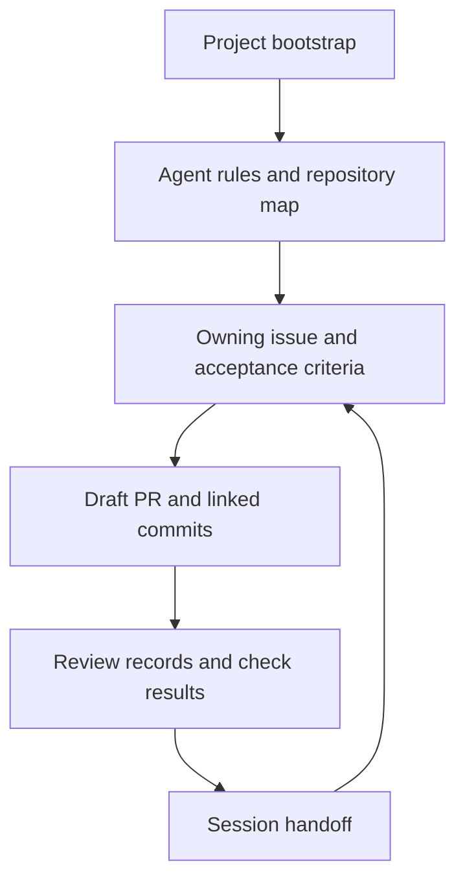
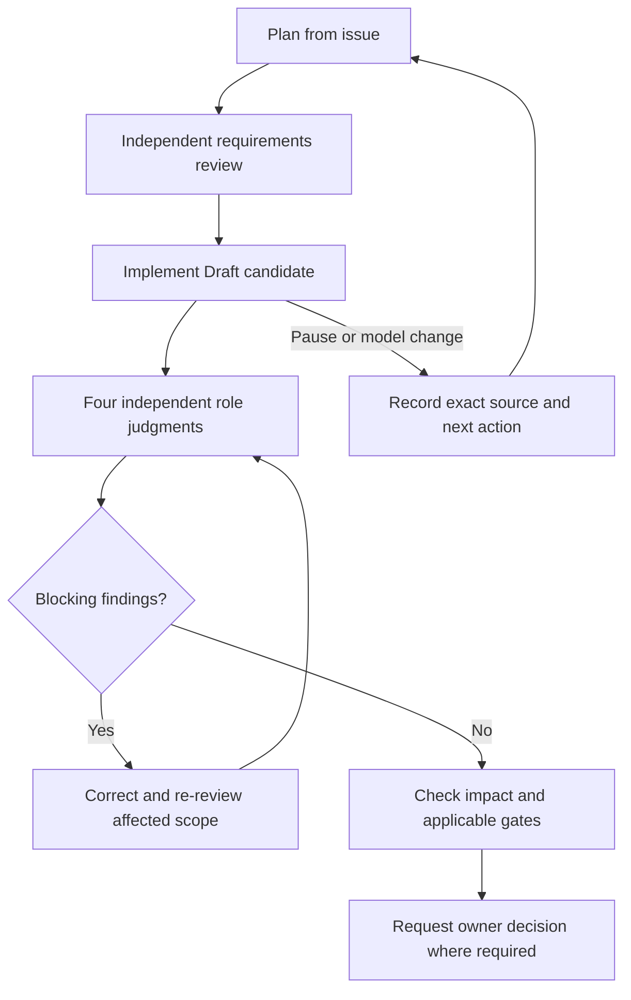
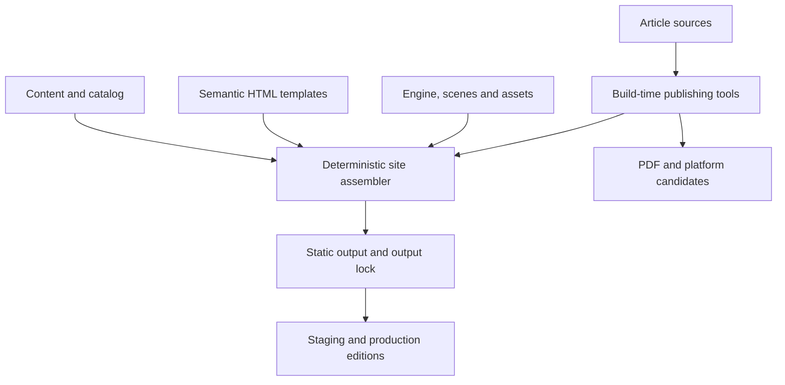
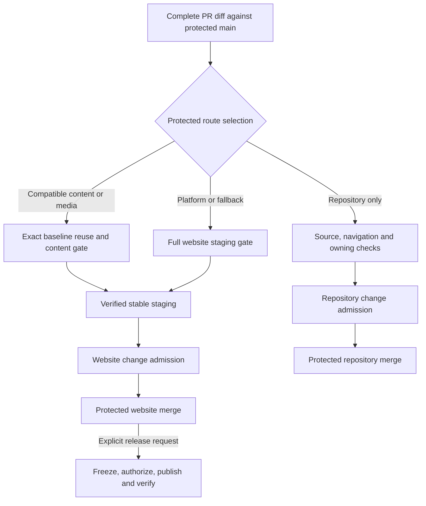

# How the author-site repository works

Vitalii Oborskyi’s author site is a static publication platform with an
interactive reading experience and an agent-assisted development workflow. The
repository separates three decisions: what the change should achieve, which
source and artifacts have been verified, and whether to change the live site.
That lets a maintainer delegate implementation and review, publish an article
without rebuilding an accepted platform, and merge maintenance without moving
the production release. This guide describes protected `main` as inspected on
12 November 2026 at [`f51d3f4`](https://github.com/oborskyivitalii/oborskyivitalii/commit/f51d3f4f49b9fa456a8fa25fc419dc17dd2307aa).

## Harness and ownership

| Where | What it controls or records |
| --- | --- |
| [Bootstrap](../PROJECT-BOOTSTRAP.md), [AGENTS](../AGENTS.md), [CONTRIBUTING](../CONTRIBUTING.md) | Start by checking live refs and reading the root and applicable scoped instructions. The task type routes the agent to owners for content (T0), code/template/style/config (T1), research input (T2), release/domain/DNS (T3), or repository management (T4). Mixed work follows all applicable routes. |
| [Repository Intelligence](../.github/REPOSITORY-INTELLIGENCE.md) | One path catalog supplies a short [repository map](../REPOSITORY-MAP.md) and a complete machine-readable inventory. Lookup leads to canonical owners and their checks. An agent can load a small current context while the producer still verifies the full indexed input set. |
| GitHub issue, PR, and [acceptance policy](../.github/ACCEPTANCE.md) | The issue owns intent, scope and stable `ACxx` criteria. The Draft PR and commits carry `Refs #N`. The owning policy maps criteria to checks and explicit human gates. GitHub Actions runs those checks against identifiable source. The [WEB-34 link-back](https://github.com/oborskyivitalii/oborskyivitalii/issues/199#issuecomment-6815453606) is an observed Linear tracking link. |
| [Versioned review](../review/REVIEW-TEMPLATE.md) and [MEMORY](../MEMORY.md) | Review artifacts retain findings, evidence and model handoffs under the same issue/PR. MEMORY holds the verified ref, decisions, remaining work and next action in five sections, within 120 lines and 8,192 UTF-8 bytes. [PR #192](https://github.com/oborskyivitalii/oborskyivitalii/pull/192) delivered the refresh protocol and bounds. A new session confirms the checkpoint against live evidence. |

This layout keeps durable rules, task-specific decisions, and working context in
their respective owners. Green automated checks establish their mapped results.
Closure also needs the applicable independent review, owner decisions and actual
delivery evidence for the issue’s criteria.

## Agents and orchestration

The maintainer owns intent and applicable merge, release, and publication
decisions. The coordinating agent plans the work, selects a model when relevant,
and delegates or implements within the owning issue. It assembles the review
packet, reconciles findings against evidence, and routes corrections back to the
implementation. A handoff between models or sessions uses the same issue, PR,
and versioned handoff. The role name describes the work the agent is responsible for.

| Independent role | Responsibility and output |
| --- | --- |
| [Requirements & Acceptance](../agents/reviewers/requirements-acceptance.md) | Before dependent implementation, challenge gaps in intent, scope, acceptance criteria and test oracles. On the candidate, trace the result back to the agreed criteria. |
| [Code / Artifact](../agents/reviewers/code-review.md) | Inspect the actual diff, ownership, failure paths and regressions. Report source-located findings and verify applicable corrections. |
| [White-box QA](../agents/reviewers/white-box-qa.md) | Derive structural risks, test scenarios and independent expected outcomes. Map applicable cases to their existing suite or workflow. |
| [Exploratory / Interaction QA](../agents/reviewers/exploratory-interaction-qa.md) | Exercise the applicable reader, operator or workflow surface. Record observations, uncovered limits and regression candidates. |

Each completed candidate iteration needs four distinct nonauthor role results.
A fresh launch explicitly uses `fork_turns="none"` or a verified equivalent.
The agent gets the applicable rules, intent, source/diff and evidence access,
with author conversation and peer verdicts withheld before its first judgment.
The common contract records the actual launch, prompt and packet identities,
reviewed source, first independent judgment, checks and limits. For
corrections, it permits a disclosed same-role continuation where applicable and
reuse of still-valid evidence for unchanged scope. The proposed stronger
freshness rule is tracked in [#198](https://github.com/oborskyivitalii/oborskyivitalii/issues/198).

Session agents produce review judgments. GitHub Actions executes deterministic
checks. The merged [offline WEB fixture](WEB-ORCHESTRATION.md) models decisions,
dispatch proposals and recovery states on synthetic inputs. It has no live
dispatcher or reviewer admission. Adapter work
remains under [#167](https://github.com/oborskyivitalii/oborskyivitalii/issues/167)
and [Draft PR #171](https://github.com/oborskyivitalii/oborskyivitalii/pull/171).
See the [review lifecycle](../CONTRIBUTING.md#independent-quality-agents) and
[launch contract](../agents/reviewers/README.md) for exact obligations.

## Site architecture

`site/content/` owns validated page data and the publication catalog.
`site/templates/` owns shared semantic HTML and reusable components.
`site/engine/`, `site/scenes/` and `site/effects/` supply navigation, Canvas
rendering and motion. Complete HTML, native links, anchors, and article text
work without JavaScript. The browser runtime enhances that baseline with
persistent navigation, scene transitions and a shared animation lifecycle.

`site/publications/` owns article manuscripts, metadata and profiles.
`tools/publishing/` validates and adapts those sources at build time for the
reader and separate PDF and platform candidates. `tools/site/` validates inputs,
renders affected outputs and updates the output lock with input dependencies
and hashes. `docs/` is generated public output. The staging and production
controllers prepare their respective editions from verified generation. Research
claims and evidence retain their [upstream repository owners](REPOSITORIES.md).

The local build cache accelerates generation. The compatible content route
requires a separately authenticated baseline, and the release archive freezes
the exact edition the publisher may serve. Each has a different trust boundary.

The split lets a manuscript, catalog record or local figure change within the
existing presentation contract. Template, schema, engine, global asset or
toolchain changes can alter shared behavior across routes and require platform
verification. See the [source and engine contract](../site/README.md) and
[article workflow](ARTICLE-WORKFLOW.md).

## Delivery routes and controls

| Example | What the route checks and who advances it |
| --- | --- |
| Root agent instructions and eligible navigation metadata | The repository route runs applicable source, navigation/RI and owning checks. Maintainer-authorized change admission precedes protected merge. Website builds and staging are inapplicable to this route. A new path under `guides/` can take the full route when the protected classifier has no complete disposition for it. |
| A bounded change to `tools/repository_intelligence.py` with compatible companions | The technical route retains affected source tests, security, RI and owning acceptance. Executable controls require review of the exact PR head. Review scope and hosted dependency are separate decisions. |
| An article update with a compatible platform | The content/media route authenticates an accepted baseline and relevant history, then uses the same assembler to rebuild affected outputs and prove platform bytes stayed exact. The content gate runs current scanners, checks affected hosted bytes and desktop/mobile reading with JavaScript on and off, and records inherited platform evidence. |
| The same article update with a missing or incompatible baseline | The selector falls back to full assembly and staging. A passing preview supplies neither baseline provenance nor platform acceptance. |
| A shared template or engine change | The full route verifies shared behavior, with bounded browser, failure, navigation and performance cases in staging. Mixed or unknown effects also fall back to this route. |
| This guide, guide index and its owning policy | At the documented base, the two guide paths lack a complete dependency disposition and the policy is a control. The full route applies: finish current-head checks, request owner staging and require exact-head control review before change admission and protected merge. |

Before advancing, review test impact against the full current diff. A failure
stops advancement. Preserve the first failure and its source, diagnose the
smallest useful scope, then verify the correction. Revalidate evidence if source,
base, policy or artifact identity has changed. The observation workflow describes
status and possible next steps. For a website change, Ready and successful
current-head source, navigation and owning checks precede the owner’s staging
request, with visual approval where applicable. The owner separately requests
change admission from protected main. Control changes bind that decision to
the full `reviewed_sha` of the PR. The dedicated GitHub App issues admission for
the selected source, then the protected merge checks that admission and the
remaining applicable evidence.

Cloudflare Pages serves immutable PR preview versions and a stable staging alias.
An isolated regression run can produce evidence without updating the alias.
Production uses GitHub Pages at the canonical `.ai` origin. The production
candidate authenticates successful staging and the identical merged source tree,
then freezes the production edition and rights inventory. The authorized
publisher consumes that archive, verifies served routes and bytes, and records the
production identity. The complete production diagnostic is available separately.
The [staging controller](SITE-STAGING.md), [check profiles](SITE-CHECK-PROFILES.md),
[content release contract](SITE-CONTENT-RELEASE.md), and [release gates](SITE-RELEASE-GATES.md)
own these details. These are the main workflow entry points.

| Stage | Workflow and responsibility |
| --- | --- |
| PR feedback and acceptance | [Source checks](../.github/workflows/site-checks.yml), [navigation](../.github/workflows/navigation.yml) and [owning acceptance](../.github/workflows/issue-acceptance.yml) report applicable results on the PR source. [Delivery observation](../.github/workflows/delivery-observation.yml) reports obligations and evidence state. |
| Preview and staging | [Site PR preview and staging](../.github/workflows/site-color-review.yml) handles Cloudflare previews and owner staging requests, including `/stage`. It calls the [site release checks](../.github/workflows/site-release-checks.yml) and verifies the matching candidate and gate before promotion. The source workflow also has a [separate trusted staging entry](../.github/workflows/site-staging.yml). |
| Repository admission and merge | [Change admission](../.github/workflows/change-admission.yml) runs from protected main for a specific PR and binds the selected obligations to its current source. [Post-merge verification](../.github/workflows/site-staging-merge.yml) records repository or website identity after merge. |
| Production | [Release candidate](../.github/workflows/site-release-candidate.yml) freezes the authenticated edition. [Authorized production](../.github/workflows/site-production.yml) publishes or rolls back a complete admitted package. |

## Evidence from shipped changes

- **Platform first.** [#122](https://github.com/oborskyivitalii/oborskyivitalii/issues/122#issuecomment-6453681483)
  delivered the split and the reader runtime to production. The planned essay in
  PR #79 stayed on its own publication path.
- **Article release.** [#169](https://github.com/oborskyivitalii/oborskyivitalii/issues/169#issuecomment-6770507949)
  traces the [authored SDLC essay](../site/publications/sdlc-out-of-balance/manuscript.en.md) through its
  [frozen R12 edition](../site/publications/sdlc-out-of-balance/editions/sdlc-out-of-balance-en-r12-20261110.json),
  [immutable site release](https://github.com/oborskyivitalii/oborskyivitalii/releases/tag/prod-2026-11-10.1),
  [production run](https://github.com/oborskyivitalii/oborskyivitalii/actions/runs/42814230443),
  PDF and prepared distribution editions. The acceptance record links the
  served verification. The
  [site-first sequence](ARTICLE-WORKFLOW.md#site-first-distribution)
  verifies the canonical site edition before external publication and records
  observed external URLs after publication.
- **Rules-only delivery.** [PR #144](https://github.com/oborskyivitalii/oborskyivitalii/pull/144)
  shows ordinary repository delivery. Its [post-merge run](https://github.com/oborskyivitalii/oborskyivitalii/actions/runs/40131619768)
  records website work as inapplicable.
- **Repository delivery.** [#189](https://github.com/oborskyivitalii/oborskyivitalii/issues/189)
  made the current navigation map smaller and preserved archived evidence
  byte-for-byte. [Post-merge verification](https://github.com/oborskyivitalii/oborskyivitalii/actions/runs/42993357348)
  recorded identical reviewed and merged trees and unchanged public bytes. The
  production ref stayed on the earlier [release](https://github.com/oborskyivitalii/oborskyivitalii/releases/tag/prod-2026-11-10.1).
