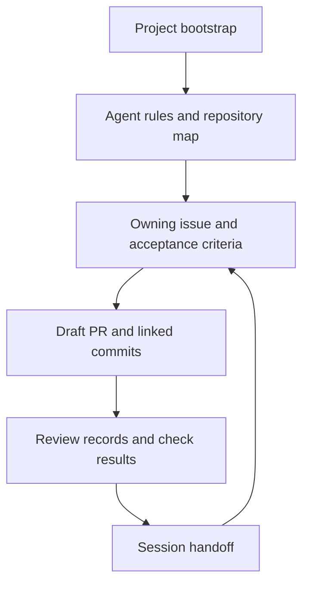
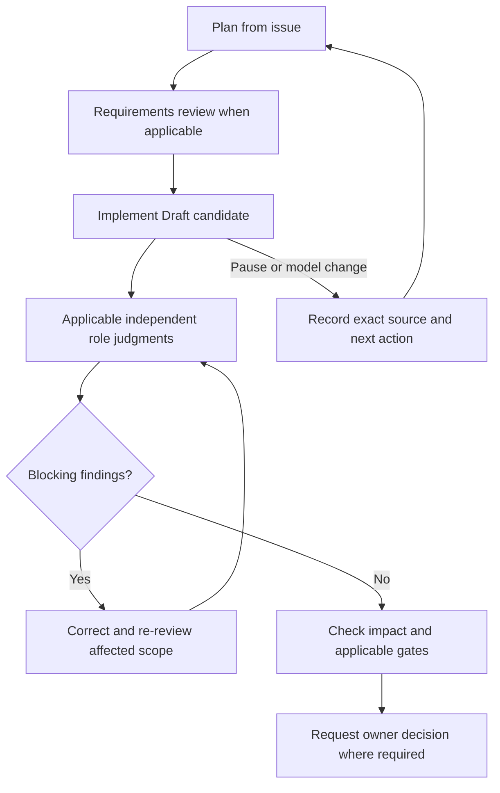
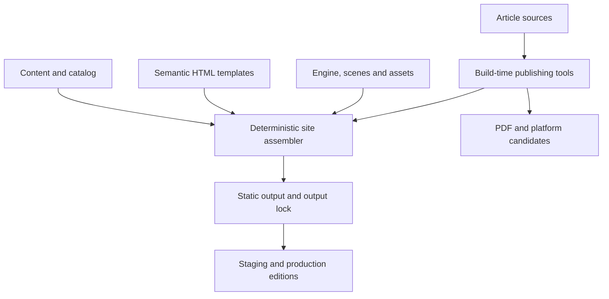
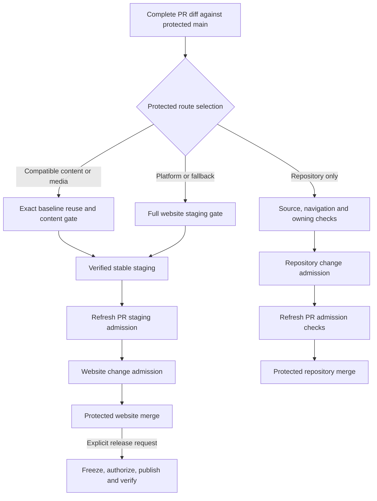

# How the author-site repository works

Vitalii Oborskyi’s author site is a static publication platform with an
interactive reading experience and an agent-assisted development workflow. The
repository separates three decisions: what the change should achieve, which
source and artifacts have been verified, and whether to change the live site.
That lets a maintainer delegate implementation and review, publish an article
without rebuilding an accepted platform, and merge maintenance without moving
the production release. The linked contracts define the active routes and the decisions each route owns.

## Harness and ownership

| Where | What it controls or records |
| --- | --- |
| [Bootstrap](../PROJECT-BOOTSTRAP.md), [AGENTS](../AGENTS.md), [CONTRIBUTING](../CONTRIBUTING.md) | Start by checking live refs and reading the root and applicable scoped instructions. The task type routes the agent to owners for content (T0), code/template/style/config (T1), research input (T2), release/domain/DNS (T3), or repository management (T4). Mixed work follows all applicable routes. |
| [Repository Intelligence](../.github/REPOSITORY-INTELLIGENCE.md) | One path catalog supplies a short [repository map](../REPOSITORY-MAP.md) and a complete machine-readable inventory. Lookup leads to canonical owners and their checks. Use `context-for-task --scope current` for active work, `history` for prior evidence or `all` for the complete inventory. The producer verifies the full indexed input set. |
| GitHub issue, PR, and [acceptance policy](../.github/ACCEPTANCE.md) | The issue owns intent, scope and stable `ACxx` criteria. The Draft PR and commits carry `Refs #N`. The owning policy maps criteria to checks and explicit human gates. GitHub Actions runs those checks against identifiable source. The [WEB-34 link-back](https://github.com/oborskyivitalii/oborskyivitalii/issues/199#issuecomment-6815453606) is an observed Linear tracking link. |
| [Versioned review](../review/REVIEW-TEMPLATE.md) and [MEMORY](../MEMORY.md) | Review artifacts retain findings, evidence and model handoffs under the same issue/PR. MEMORY holds the verified ref, decisions, remaining work and next action in five sections, within 120 lines and 8,192 UTF-8 bytes. [PR #192](https://github.com/oborskyivitalii/oborskyivitalii/pull/192) delivered the refresh protocol and bounds. A new session confirms the checkpoint against live evidence. |

This layout keeps durable rules, task-specific decisions, and working context in
their respective owners. Green automated checks establish their mapped results.
Closure also needs the applicable independent review, owner decisions and actual
delivery evidence for the issue’s criteria.

## Agents and orchestration

The maintainer owns intent and applicable merge, release, and publication
decisions. The coordinating agent plans the work, selects a model when relevant,
and delegates or implements within the owning issue. It assembles the review
packet, reconciles findings against evidence, and routes corrections back to the
implementation. A handoff between models or sessions uses the same issue, PR,
and versioned handoff. The role name describes the work the agent is responsible for.

| Independent role | Responsibility and output |
| --- | --- |
| [Requirements & Acceptance](../agents/reviewers/requirements-acceptance.md) | When intent, requirements, acceptance criteria, test oracles or acceptance rules change, challenge gaps before dependent implementation. On the candidate, trace the result back to the agreed criteria. |
| [Code / Artifact](../agents/reviewers/code-review.md) | Inspect the actual diff, ownership, failure paths and regressions. Report source-located findings and verify applicable corrections. |
| [White-box QA](../agents/reviewers/white-box-qa.md) | Derive structural risks, test scenarios and independent expected outcomes. Map applicable cases to their existing suite or workflow. |
| [Exploratory / Interaction QA](../agents/reviewers/exploratory-interaction-qa.md) | Exercise the applicable reader, operator or workflow surface. Record observations, uncovered limits and regression candidates. |

The plan names the applicable roles from the complete diff and owning policy.
Unknown scope holds advancement. Trust, routing, acceptance and cross-page
runtime changes use all four roles.
A bounded generator change uses code and white-box review, adding Requirements
when the test oracle changes. Exploratory review follows the affected reader
or operator surface. Explicit owning gates still apply. A fresh launch uses `fork_turns="none"` or a verified
equivalent. Each reviewer receives the role prompt, applicable rules, intent,
source/diff and evidence access. Author conversation and peer verdicts stay
outside the packet. Review records identify the launch, prompt and packet,
reviewed source, first judgment and limits. Correction review uses a fresh
distinct reviewer with the affected finding IDs and evidence. A same-handle
followup can clarify an existing record. Prior coverage can carry forward
where the source, dependencies, prompts and test oracle remain unchanged and no
new pass is required. An explicit new review supersedes prior evidence even on
the same SHA.

Session agents make review judgments. GitHub Actions runs deterministic checks.
The [parent-mediated reviewer admission](WEB-ORCHESTRATION.md#parent-mediated-reviewer-admission)
delivered in [#198](https://github.com/oborskyivitalii/oborskyivitalii/issues/198)
validates role packets and receipts at the repository boundary. The parent
prepares a role-specific packet for the exact source and test oracle, launches
a fresh reviewer with no conversation inheritance, then imports the observed
tool response and result for admission. The retained checkpoint records the
latest attempt. A newer preparation or pending launch holds the gate. The receipt links role, handle,
phase and reviewed source to the observed launch and first judgment. Pending,
missing, stale or contaminated evidence holds the affected gate until reconciled
or replaced. Parent observation covers arguments and receipts. Provider
internals and shared-context exposure require separate evidence. The
[offline WEB fixture](WEB-ORCHESTRATION.md) models dispatch proposals and
recovery on synthetic inputs. Wider live adapter and pilot work are tracked
in [#167](https://github.com/oborskyivitalii/oborskyivitalii/issues/167) and
[Draft PR #171](https://github.com/oborskyivitalii/oborskyivitalii/pull/171).
See the [review lifecycle](../CONTRIBUTING.md#independent-quality-agents) and
[launch contract](../agents/reviewers/README.md).

## Keeping this guide current

A PR that changes workflows, reusable actions, harness rules or checks, authored
Repository Intelligence, agent contracts, orchestration or delivery controls
must review the affected sections of this guide. Include substantive corrections
in the same PR. Navigation compares the immutable PR base and head. Protected
[Change admission](../.github/workflows/change-admission.yml) repeats the check
from current main, including its final evidence recheck. The scope covers
additions, removals and both sides of renames. Generated RI refreshes, routine
handoffs, issue-specific acceptance policies and ordinary site content use their
existing checks.

When the guide already describes the changed behavior, run
`python3 tools/check_ri_ci.py guide-scope --base-sha BASE --head-sha HEAD`
against the committed candidate. In
`review/issue-N/workflow-guide-evidence.json`, enter the reported `base_sha`,
`scope_sha256` and `paths`, plus the affected guide `sections`, a specific
`rationale` and the recorded `reviewer_execution` reference. A change to the
base or covered source requires a fresh record.

For either decision, record the independent guide review against the exact
candidate. The owner verifies the review and sets `guide_reviewed_sha` and
`guide_review_evidence` (a link to the accepted review record in this GitHub repository) when dispatching
Change admission. The protected report retains that exact-head attestation. Navigation detects missing or stale
evidence and ignores whitespace and HTML comments. Use inline Markdown links
in the guide. Reference definitions are rejected so they cannot be counted as
documentation changes. Reviewers judge
whether the affected text, diagrams and examples accurately describe the
change. The protected enforcement becomes active when this guard reaches main. During
the documented [App outage recovery](SITE-STAGING.md#ordered-protection-activation-and-recovery),
the original required Navigation check still runs and the owner verifies the
independent review in the full staging and control review.

## Site architecture

`site/content/` owns validated page data and the publication catalog.
`site/templates/` owns shared semantic HTML and reusable components.
`site/engine/`, `site/scenes/` and `site/effects/` supply navigation, Canvas
rendering and motion. Complete HTML, native links, anchors, and article text
work without JavaScript. The browser runtime enhances that baseline with
persistent navigation, scene transitions and a shared animation lifecycle.

`site/publications/` owns article manuscripts, metadata and profiles.
`tools/publishing/` validates and adapts those sources at build time for the
reader and separate PDF and platform candidates. `tools/site/` validates inputs,
renders affected outputs and updates the output lock with input dependencies
and hashes. `docs/` is generated public output. The staging and production
controllers prepare their respective editions from verified generation. Research
claims and evidence retain their [upstream repository owners](REPOSITORIES.md).

The local build cache accelerates generation. The compatible content route
requires a separately authenticated baseline, and the release archive freezes
the exact edition the publisher may serve. Each has a different trust boundary.

The split lets a manuscript, catalog record or local figure change within the
existing presentation contract. Template, schema, engine, global asset or
toolchain changes can alter shared behavior across routes and require platform
verification. See the [source and engine contract](../site/README.md) and
[article workflow](ARTICLE-WORKFLOW.md).

## Delivery routes and controls

| Example | What the route checks and who advances it |
| --- | --- |
| Root agent instructions and eligible navigation metadata | The repository route runs applicable source, navigation/RI and owning checks. Maintainer-authorized change admission precedes protected merge. Website builds and staging are inapplicable to this route. A new path under `guides/` can take the full route when the protected classifier has no complete disposition for it. |
| A bounded change to `tools/repository_intelligence.py` with compatible companions | The technical route retains affected source tests, security, RI and owning acceptance. Executable controls require review of the exact PR head. Review scope and hosted dependency are separate decisions. |
| An article update with a compatible platform | The content/media route authenticates an accepted baseline and relevant history, then uses the same assembler to rebuild affected outputs and prove platform bytes stayed exact. The content gate runs current scanners, checks affected hosted bytes and desktop/mobile reading with JavaScript on and off, and records inherited platform evidence. |
| The same article update with a missing or incompatible baseline | The selector falls back to full assembly and staging. A passing preview supplies neither baseline provenance nor platform acceptance. |
| A shared template or engine change | The full route verifies shared behavior, with bounded browser, failure, navigation and performance cases in staging. Mixed or unknown effects also fall back to this route. |
| This guide and its enforcement | At the documented base, the two guide paths lack a complete dependency disposition, and the owning policy, checker and admission workflow change controls. The full route applies: finish current-head checks, request owner staging and require exact-head control review before change admission and protected merge. |

Before advancing, review test impact against the full current diff. A failure
stops advancement. Preserve the first failure and its source, diagnose the
smallest useful scope, then verify the correction. Revalidate evidence if source,
base, policy or artifact identity has changed. The observation workflow describes
status and possible next steps. For a website change, Ready and successful
current-head source, navigation and owning checks precede the owner’s staging
request, with visual approval where applicable. After stable staging succeeds,
the owner edits the PR description to refresh the PR-event Staging admission
check. The owner separately requests Change admission from protected main. Control changes bind that decision to
the full `reviewed_sha` of the PR. The dedicated GitHub App issues admission for
the selected source, then the protected merge checks that admission and the
remaining applicable evidence. On the repository-only route the owner edits
the PR description after the App decision to refresh the conditional Staging
admission and owning checks, without running website staging.

Cloudflare Pages serves immutable PR preview versions and a stable staging alias.
An isolated regression run can produce evidence without updating the alias.
Production uses GitHub Pages at the canonical `.ai` origin. The production
candidate authenticates successful staging and the identical merged source tree,
then freezes the production edition and rights inventory. The authorized
publisher consumes that archive, verifies served routes and bytes, and records the
production identity. The complete production diagnostic is available separately.
The [staging controller](SITE-STAGING.md), [check profiles](SITE-CHECK-PROFILES.md),
[content release contract](SITE-CONTENT-RELEASE.md), and [release gates](SITE-RELEASE-GATES.md)
own these details. These are the main workflow entry points.

| Stage | Workflow and responsibility |
| --- | --- |
| PR feedback and acceptance | [Source checks](../.github/workflows/site-checks.yml), [navigation](../.github/workflows/navigation.yml) and [owning acceptance](../.github/workflows/issue-acceptance.yml) report applicable results on the PR source. [Delivery observation](../.github/workflows/delivery-observation.yml) reports obligations and evidence state. |
| Preview and staging | [Site PR preview and staging](../.github/workflows/site-color-review.yml) handles Cloudflare previews and owner staging requests, including `/stage`. It calls the [site release checks](../.github/workflows/site-release-checks.yml) and verifies the matching candidate and gate before promotion. The source workflow also has a [separate trusted staging entry](../.github/workflows/site-staging.yml). |
| Repository admission and merge | [Change admission](../.github/workflows/change-admission.yml) runs from protected main for a specific PR and binds the selected obligations to its current source. [Post-merge verification](../.github/workflows/site-staging-merge.yml) records repository or website identity after merge. |
| Production | [Release candidate](../.github/workflows/site-release-candidate.yml) freezes the authenticated edition. [Authorized production](../.github/workflows/site-production.yml) publishes or rolls back a complete admitted package. |

## Evidence from shipped changes

- **Platform first.** [#122](https://github.com/oborskyivitalii/oborskyivitalii/issues/122#issuecomment-6453681483)
  delivered the split and the reader runtime to production. The planned essay in
  PR #79 stayed on its own publication path.
- **Article release.** [#169](https://github.com/oborskyivitalii/oborskyivitalii/issues/169#issuecomment-6770507949)
  traces the [authored SDLC essay](../site/publications/sdlc-out-of-balance/manuscript.en.md) through its
  [frozen R12 edition](../site/publications/sdlc-out-of-balance/editions/sdlc-out-of-balance-en-r12-20261110.json),
  [immutable site release](https://github.com/oborskyivitalii/oborskyivitalii/releases/tag/prod-2026-11-10.1),
  [production run](https://github.com/oborskyivitalii/oborskyivitalii/actions/runs/42814230443),
  PDF and prepared distribution editions. The acceptance record links the
  served verification. The
  [site-first sequence](ARTICLE-WORKFLOW.md#site-first-distribution)
  verifies the canonical site edition before external publication and records
  observed external URLs after publication.
- **Rules-only delivery.** [PR #144](https://github.com/oborskyivitalii/oborskyivitalii/pull/144)
  shows ordinary repository delivery. Its [post-merge run](https://github.com/oborskyivitalii/oborskyivitalii/actions/runs/40131619768)
  records website work as inapplicable.
- **Repository delivery.** [#189](https://github.com/oborskyivitalii/oborskyivitalii/issues/189)
  made the current navigation map smaller and preserved archived evidence
  byte-for-byte. [Post-merge verification](https://github.com/oborskyivitalii/oborskyivitalii/actions/runs/42993357348)
  recorded identical reviewed and merged trees and unchanged public bytes. The
  production ref stayed on the earlier [release](https://github.com/oborskyivitalii/oborskyivitalii/releases/tag/prod-2026-11-10.1).

- **Repository-only delivery.** [PR #192](https://github.com/oborskyivitalii/oborskyivitalii/pull/192#issuecomment-6805331637)
  changed the MEMORY protocol. [Owner admission](https://github.com/oborskyivitalii/oborskyivitalii/actions/runs/43194792846)
  and [post-merge verification](https://github.com/oborskyivitalii/oborskyivitalii/actions/runs/43195181679)
  recorded the reviewed tree and preservation of site, output and production.
- **Full delivery.** [PR #195](https://github.com/oborskyivitalii/oborskyivitalii/pull/195#issuecomment-6793684977)
  added platform-specific image preparation for LinkedIn and Medium copy-ready
  kits. The exact-head [preview smoke](https://github.com/oborskyivitalii/oborskyivitalii/actions/runs/43302694504/job/131478920446)
  passed before [owner-requested stable staging](https://github.com/oborskyivitalii/oborskyivitalii/actions/runs/43303498877).
  The separate [Change admission](https://github.com/oborskyivitalii/oborskyivitalii/actions/runs/43387929041)
  preceded the [protected merge](https://github.com/oborskyivitalii/oborskyivitalii/commit/59085a352405eb8fb4a565c1308d2c75955a9738).
  [Post-merge verification](https://github.com/oborskyivitalii/oborskyivitalii/actions/runs/43388137218)
  recorded the resulting source identity. The [article workflow](ARTICLE-WORKFLOW.md)
  owns image sizing and the author’s separate publication handoff.
