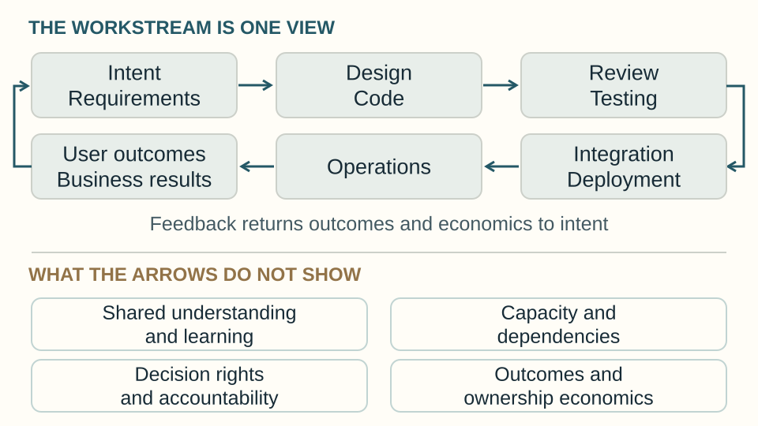
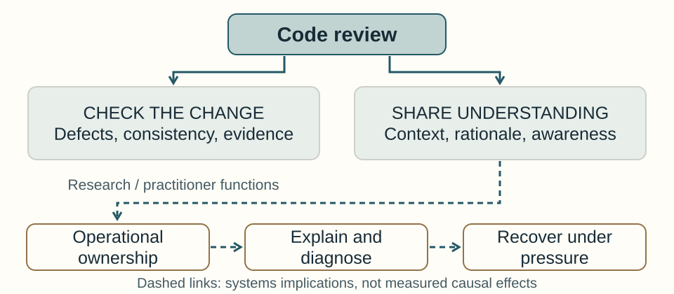
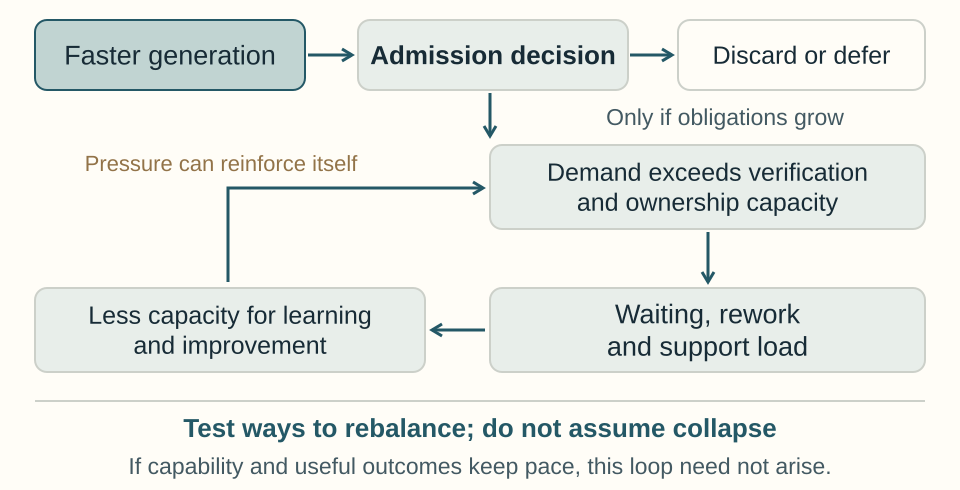

# The SDLC Is Out of Balance — R1 author-review source

Author: Vitalii Oborskyi. Date: 31 October 2026.
Owner: [issue169](https://github.com/oborskyivitalii/oborskyivitalii/issues/169) / [Draft PR170](https://github.com/oborskyivitalii/oborskyivitalii/pull/170).

Read [the complete Markdown manuscript](manuscript.en.md), [launch text](launch-post.en.md) and [the execution/model plan](../2026-10-31-execution-plan-r2.md).

## Figure masters

[Editable typography-cover alternative](masters/cover-typographic.svg).

## Delivery status

This directory contains the text and SVG masters. The five-page PDF, PNG figures,
AI-generated editorial cover, platform copies and full local review manifest were
prepared and provided as conversation attachments in the complete review ZIP.
They are **not committed binary files in this directory**. See the source-bound
identities and import requirements in the execution plan. Do not infer native
publisher success or public availability from a filename or hash.

The source uses the existing publisher's `asset:` convention; native metadata and
local PNG declarations are a Sol integration task. Its references include related
work for LinkedIn/Medium. Website automatic recommendations must use the existing
tag registry/component and are not claimed implemented by this source-only PR.

No publication, main merge, production release or external posting is authorised
by this draft. Four independent quality roles and author acceptance remain open.
