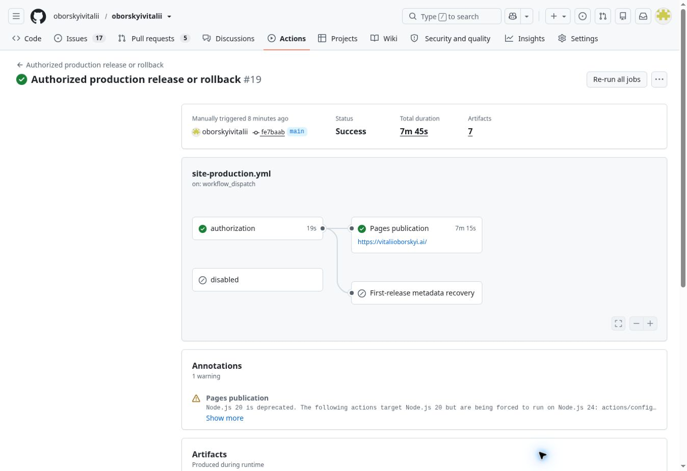

# Issue 177 — verified production analytics release
Date: 2026-11-08. Owning issue177; execution PR178. This is a publication receipt, not a claim that every original issue requirement is complete.

## Outcome and authorization
Maintainer approved stable staging, then explicitly said “Все ок, іди в прод”. Authorization is recorded in issue177 comment6727231817. This supersedes earlier stable-only stops for the unchanged analytics candidate. PR178 was merged through protected main and published by the existing controller. No new source iteration, full staging rerun, test-budget change, SEO/discovery implementation, DNS change or Medium account edit occurred.

- Tested head: `935d74e2e372965690e0a691393d98b75020122a`.
- Merged/current main and production: `fe7baab277a8b90de330a1cec738b7085faf7223`.
- Identical tested/merged tree: `721eabb59e2814f03d328a4665a9b5cdcb067651`.
- Immutable accepted release: [prod-2026-11-08.2](https://github.com/oborskyivitalii/oborskyivitalii/releases/tag/prod-2026-11-08.2).
- Production deployment ID: `7642084152`.
- Public digest: `bcb9804d9b636f8048c5baac1270ef6cd1c7af3bdab830d3365cf15797b05882`.
- Archived public package SHA256: `495e05906eaedad7d1ee87c7087524a2f9ffba29e4789da1c23997a68775fec0`.
- Frozen rights inventory: `acb0f2ec8a6e9e7235abe0161a3ac87fdc99db4853ea7d432c2e6fe0c05b145d`.

## Evidence
The [stable report](../stable-staging-2026-11-08/final-report.md) preserves the source1253/1253, owning5/5, prepublication26/26/native1245/1245, actual staging browser/performance evidence, four independent nonauthor roles and correction reviews, first failures and timing. Source files were unchanged afterward.

| Gate | Exact run | Actual result |
| --- | --- | --- |
| Stable staging | [42515940915/1](https://github.com/oborskyivitalii/oborskyivitalii/actions/runs/42515940915) | SUCCESS on tested head935d74e2 |
| Dedicated change admission | [42524552435/1](https://github.com/oborskyivitalii/oborskyivitalii/actions/runs/42524552435) | SUCCESS; genuine Change admission check128865317034 from App5453173 |
| Edited PR required refresh | [42524673550](https://github.com/oborskyivitalii/oborskyivitalii/actions/runs/42524673550), [42524673545](https://github.com/oborskyivitalii/oborskyivitalii/actions/runs/42524673545) | Both SUCCESS before clean protected merge |
| Accepted merge identity | [42524812310/1](https://github.com/oborskyivitalii/oborskyivitalii/actions/runs/42524812310) | SUCCESS; unchanged full source tree |
| Merged navigation/RI | [42524812040](https://github.com/oborskyivitalii/oborskyivitalii/actions/runs/42524812040) | SUCCESS |
| Frozen production candidate | [42524884283/1](https://github.com/oborskyivitalii/oborskyivitalii/actions/runs/42524884283) | build/publish/http SUCCESS; production derives from accepted identical staged source |
| Production publication | [42525094251/1](https://github.com/oborskyivitalii/oborskyivitalii/actions/runs/42525094251) | SUCCESS, 7m45s; Pages publication7m15s; no rollback |

Actual production receipts: exact Pages composition/query/404 PASS, production TLS/MIME/canonical/indexing policy PASS, four desktop/mobile normal/no-canvas smoke rows PASS, Color PASS, publication-tag checks PASS, one article/five article observations with no failed rows. Thirteen QA contexts retained collector-abort isolation, with231 blocked collector attempts and no isolation failure. These QA requests are not reader totals.

The immutable release retains archive.json, rights.json, public.tar.gz, original staging/candidate evidence, activation.json and observations.tar.gz. Activation asset SHA256 is `18b7c7246f5db29d1d90a846973c4eb5b282b32d5d7ff3c344cbc262d72db0d6`; its verified observation passes Pages, production policy and browser with retained evidence and deployment7642084152. Observations artifact13634958670 ZIP SHA256 is `4bfafc8a0e580b451e135c4ac00c559bfb88e702951a384e1cdda59a5e018e12`. Downloaded candidate, observations and activation bytes were checked against the provider digests.

An ordinary direct browser visit to the [live article](https://vitaliioborskyi.ai/articles/the-sdlc-is-out-of-balance.html) observed: correct title/content, no busy/staging badge, index,follow, the exact self-canonical, one analytics loader and one real Cloudflare SDK with status loaded. See live-article.json. This deliberate visit is separate from isolated QA; it is not evidence of exactly-once provider pageviews or aggregate receipt. No provider readership or causal-uplift claim is made.

## Original acceptance disposition
| AC | Disposition and remaining obligation |
| --- | --- |
| AC01 | OPEN/partial: analytics ownership/test-impact audit is preserved; original broader SEO/search audit is not fully accepted. |
| AC02 | OPEN/partial: actual direct live SDK loads once; fixture canonical/reload/alias/internal/history passes. Real vendor-generated history/query/fragment/pageview semantics and aggregate receipt remain distinct pending evidence. |
| AC03 | OPEN/partial: actual staging/offline/refusal/blocked checks and production QA isolation pass; original complete LIVE semantics remain pending. |
| AC04 | OPEN: observed production self-canonical is recorded, but no new truthful date/author metadata implementation/semantic acceptance in this analytics release. |
| AC05 | OPEN: original new Home/Research/article-to-Medium discovery work remains unimplemented. Existing Writing links are retained. |
| AC06 | OPEN: no new Search Console/indexing acceptance; do not infer indexing from live policy checks. |
| AC07 | PASS for the delivered analytics change: Basic/style/RI/RI-CI, four independent roles, source-bound preview/staging, separate owner production authorization and exact accepted live publication are all linked above. |
| AC08 | OPEN: reproducible equal-window provider before/after reporting remains pending; pre-fix article counts are incomplete. |
| AC09 | OPEN: post-production owner reminder below is delivered; only the owner can supply the final disposition. |

## ACTION REQUIRED — OWNER / MEDIUM CANONICAL
Original: https://vitaliioborskyi.ai/articles/the-sdlc-is-out-of-balance.html
Medium: https://aiadvances.org/the-sdlc-is-out-of-balance-beyond-the-ai-code-review-bottleneck-ca64e0b10b99

Now that this production version is verified live, the maintainer must personally open the Medium article editor/publication settings, find canonical/advanced SEO if available, set it to the original site URL, save/publish, and inspect the actual live rel=canonical. Report DONE / UNAVAILABLE / DECIDED NOT TO SET, including any UI restriction or decision. The agent did not modify Medium. Keep AC09 and issue177 open until this and the other original obligations have a recorded disposition.

## Handoff
Analytics implementation is MERGED and VERIFIED LIVE. Do not rerun staging or publish this candidate again. Main/production are fe7baab2; source tree721eabb5. Continue only the next separately selected original issue177 obligation. Earlier MEMORY.md stable-only text is dated history superseded by the current authorization and these live receipts.
