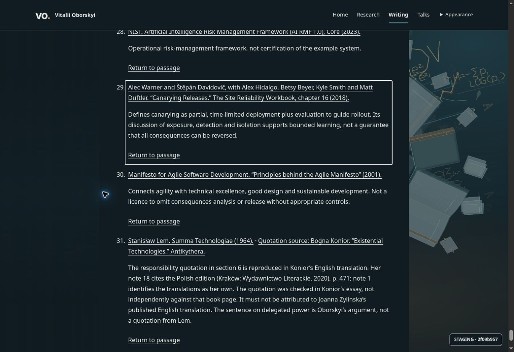
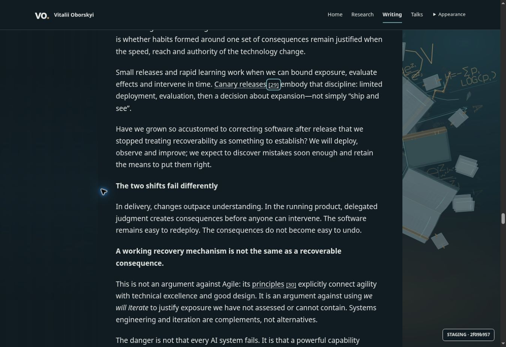

# Issue 5 — article block transitions and source reading

Owner: [issue5 dated scope](https://github.com/oborskyivitalii/oborskyivitalii/issues/5#issue5-reader-motion-20261019).
Execution: [Draft PR79](https://github.com/oborskyivitalii/oborskyivitalii/pull/79).
Prepared source based on16561ec8cddcd82d8caf4bf05b2f53064e21e3c2,
base main82b57b8948c6c30143213b846ee2848d06f8d200. Primary implementation/self-review;
independent bounded source review by `orbit_review` under AGENTS. This is not human
whole-PR, physical-device, editorial or production acceptance.

## Intent and decisions

The author reports awkward content arrival and requests the common block wave:
Writing→article enters from below; article→Writing or another principal/higher
route exits upward. Keep the camera's independent scene/history direction and
same-fractal orbit. Implement accepted audit F01/F02 in the reusable reader:
explicit comfortable return controls and easier annotation typography.

The previous route inventory selected entire multi-screen introduction/chapter
containers. Their shared travel envelope coalesced many paragraphs into one row.
The shared inventory now selects readable children; native chapter
separators use the existing measured separator ownership. Ordinary reading stays
stationary, and the original1000ms phase,24-row bound, cancellation, hold and
native fallback remain. No new production timer, RAF, opacity fade or camera policy.

Article hierarchy directions resolve after admittedDestination: a principal-page
boot registry can omit articles until first activation. Computing startsWith
before admission was a real defect found by independent review and corrected.
Camera signs, principal-to-principal behavior, article-to-article history and
native scroll/focus restoration retain their owners.

Returns now read “Return to passage”, numbered for repeated occurrences. They
retain href/role/aria-label identities and native keyboard/no-JS behavior, have
44px minimum height and wrap as a group. A native citation :target outline makes
the destination visible without timed animation. Shared appendices change from
14px/1.7 to16px/1.75. Manuscript, semantic edition and R13 PDF are unchanged.

## Findings and execution

| Task | Owner / acceptance | Check and disposition |
| --- | --- | --- |
| T01 common article wave | navigation.js, scroll-entry.cjs; AC08/11 | Readable leaf units, upward hierarchy departure and below arrival; independent source review |
| T02 audit F01 | reader.cjs, reader.css; AC08/11 | Descriptive native returns, occurrences,44px target and destination outline |
| T03 audit F02 | reader.css; AC08/11 |16px source typography with1.75 leading, no hidden notes |
| T04 evidence closure | existing Color contract/package/tests and article-browser | New exact runtime tuple, mandatory rights allowlist; original cases/budgets retained |

CS01–CS04: edit canonical runtime, adapter and CSS owners; shared semantic
selectors, no article-ID layout or manuscript edits. CS05: maintained formatter.
CS06–CS09: existing lifetime, phase/row bounds and optional-probe failure boundary;
no new fetch/cache/clock or dependency. CS10: existing router and citation tests
extended, hosted article journey additionally records actual DOM units/CSS
keyframes and router-bound phase direction. No replacement of camera paint proof
or removal of negative cases. Bounded guard and exact policy remain required.

## Acceptance evidence

Final prepared focused router/reader/scroll/article-evidence/Color suite112/112
passed; RI28/28 and RI/CI20/20 passed. Basic16+Color10 passed on the initial
prepared increment; final exact-source policy reruns its owning checks. Exact final source/policy/hosted binding is recorded in the live
PR and issue after commit; prepared observations are not a clean-source receipt.
Independent review found and rechecked the lazy article admission defect. It
also found bare h4–h6 ink was not eligible; shared ink eligibility now includes
all supported heading levels. Appendix leaf expansion was removed after review
identified stationary native markers; existing grouped closing units are retained.
Navigation33/33 and scroll-entry42/42 passed that bounded independent review.
Independent compatibility review also found that the downstream report validator
only rechecked camera data. The shared block validator now checks both collected
and admitted reports for the new exact runtime family, preserving historical
families. Evidence9/9 passes including missing/wrong phase, direction, identity,
units, frames, row/state and nonleaf negatives. New plain/staging/production
tuples and mandatory rights admission retain all original cases/budgets.
Current-run browser results are recorded in the live PR/issue after deployment. Whole AC08/11/12 and original editorial,
rights, device, staging, real content-release and publication gates remain open.
AC13/15 retain only their existing bounded disposition. No merge or production.

## Issue synopsis

Same Draft PR79: common readable-block article transitions, hierarchy departure
independent of orbit/history, descriptive native returns and larger annotations.
Original article/PDF unchanged. Exact current-source and hosted evidence belong
to the live PR/issue; no whole acceptance or publication inferred.

## Current-producer pin follow-up

The initial exact-source policy on2f09b957/tree0005600b verified9/11 mapped checks;
DELIVERY and CONTENT-LANES failed only because the production rendition test
still expected the prior calm-reader identity. It was a real stale assertion,
not a functional delivery failure, and remains recorded as failed evidence.
Current production, authored staging and modern rights fixtures now explicitly
expect the new reader-blocks runtime. Historical-family fixtures remain pinned.
The focused production regression passes. Final exact-source policy/hosted
receipts are recorded in the owning PR/issue; no budgets, negative checks or
whole acceptance gates are relaxed.

## Observed native source path

Primary browser inspection of the2f09b957 runtime at
https://119faf3c.oborskyi-author-ci-staging.pages.dev/articles/ai-changes-both-sides-of-software-engineering,
dark desktop1363×936. Writing→article and return resolved with no retained
route waves; ordinary reading has no scroll-entry records. Source29 opened
with Enter. Measured note16px /28px; return136.906×44px. Enter on the return
restored focus to reader-cite-29-1 at viewport top217.938px with a solid native
outline. All44 generated returns have native targets. No measured contrast,
physical-mobile or screen-reader acceptance is inferred. Follow-up changes
only current test pins and evidence; final source/CI binding belongs to PR79.

## Synthetic diagnostic follow-up

Initial CI39327003063 passed actual article HTTP/reader/Color reports, including
1440/390 normal,390 Off/reduced/no-canvas/no-JS,20 document flights and40 raw
block phases. Article arrival had10 rows at1440 and9 at390; all principal
article departures were forward/upward. The run as a whole FAILED on the
separate isolated synthetic content fixture: the new evidence collector required
frames on an empty zero-height tags placeholder. It also read only the first
child's animations. That is a diagnostic defect, not a passed whole workflow.

The collector now excludes only shell-and-direct-children geometry with no
positive area and collects frames from every direct child. Positive-area bare
text remains included and must have real motion. A bounded VM regression covers
empty placeholder, hidden first child/later animated child, zero-height shell
with painted child and bare-H4 missing frames. Evidence10/10, formatter and
zero-error lint pass; existing28/28 lint warnings are unchanged. Canonical
synthetic output was inspected: appendices always retain source/rights sections;
no positive-area empty-container exemption or assertion relaxation was added.
Runtime, tuples, browser cases and budgets are unchanged.

The intermediate fe53cd23/tree07783372 exact policy passed11/11,
evidence_valid:true and errors:[], report SHA256
29cca18dba444d809d29763c1a97abbb07b8811748832c85ac37b7a1ff10eebf.
Relevant current production/staging/modern-rights tests passed3/3. An optional
broader local three-module diagnostic was canceled by network approval before
a decision returned; it supplies no full-suite receipt. The bounded relevant
paths and original owning/hosted routes remain the acceptance evidence.

Independent visual reviewer checked both saved source/return states and found
F01/F02 addressed, with no scoped visual blocker. This is bounded dark-desktop
agent review; no human, physical-device or measured contrast acceptance.
Final current-source policy and hosted receipt are recorded in PR79/issue5.

## Complete supported leaf geometry

Leaf inventory also needs a movable child for the admitted thematicBreak node:
a bare nativehr has no child ink. The reader-only AST hook now emits a plain
div.reader-divider around the nativehr. The existing preservation test covers
this wrapper and unchanged AST/platform output. No layout/typography rule or
new animation owner is introduced. The new exact producer family
issue5ReaderBlockElements preserves all four runtime scripts and CSS byte for
byte; previous reader-block families remain historical. Plain/staging/production
registration, mandatory rights admission, current producer pins and block-evidence
validation explicitly include the new identity. Independent read-only review
found no blocker and checked the five equal file hashes across all three editions.
Focused reader/evidence/Color39/39 and relevant independent3/3 checks passed.
Final source policy/hosted receipts remain in the live PR/issue.
