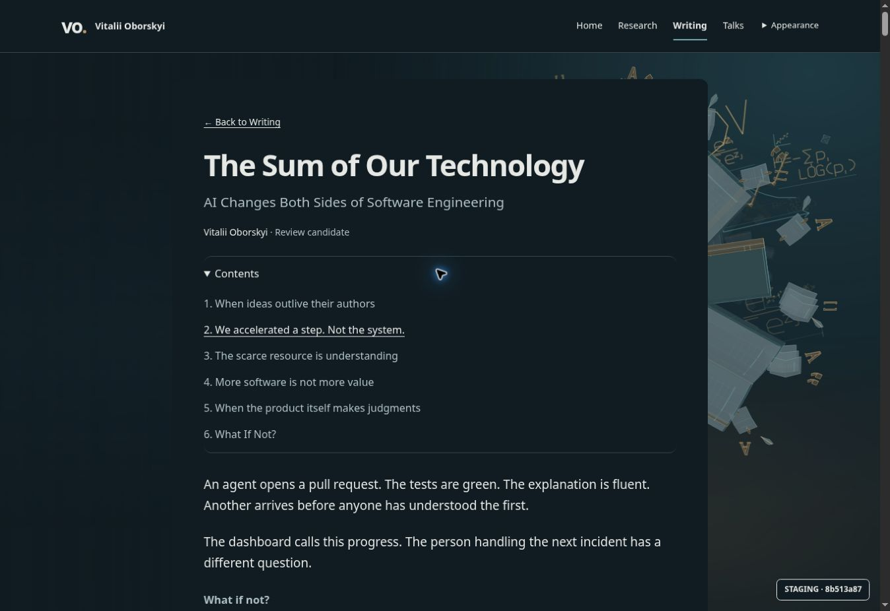
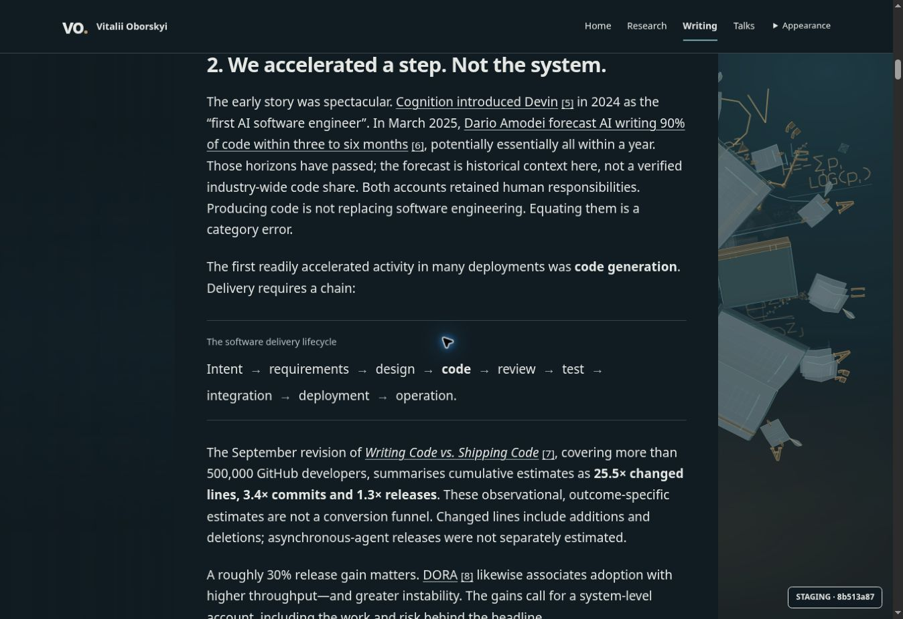
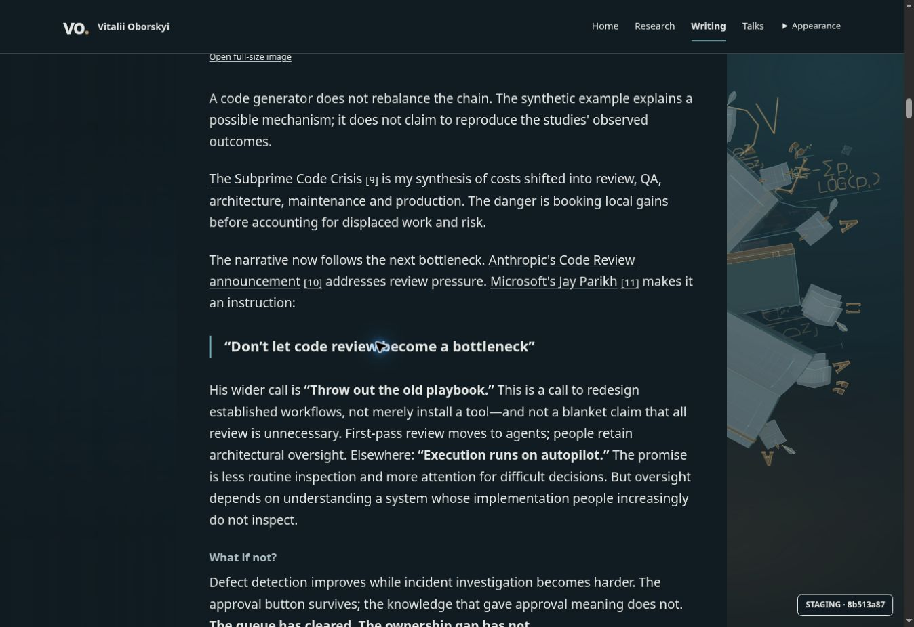
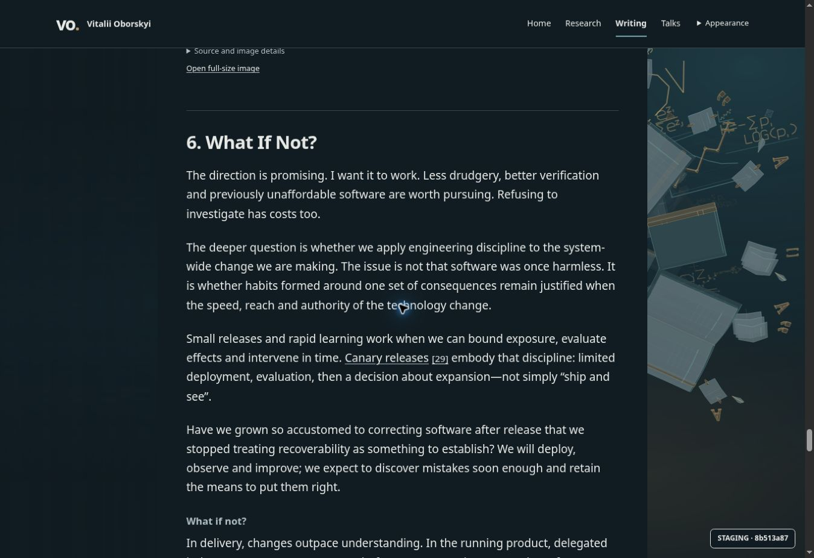
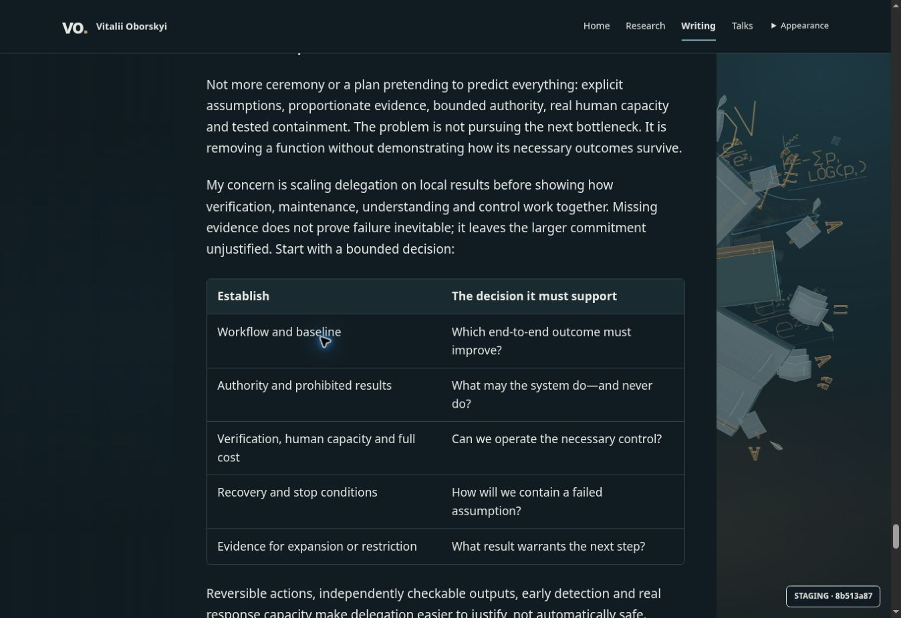
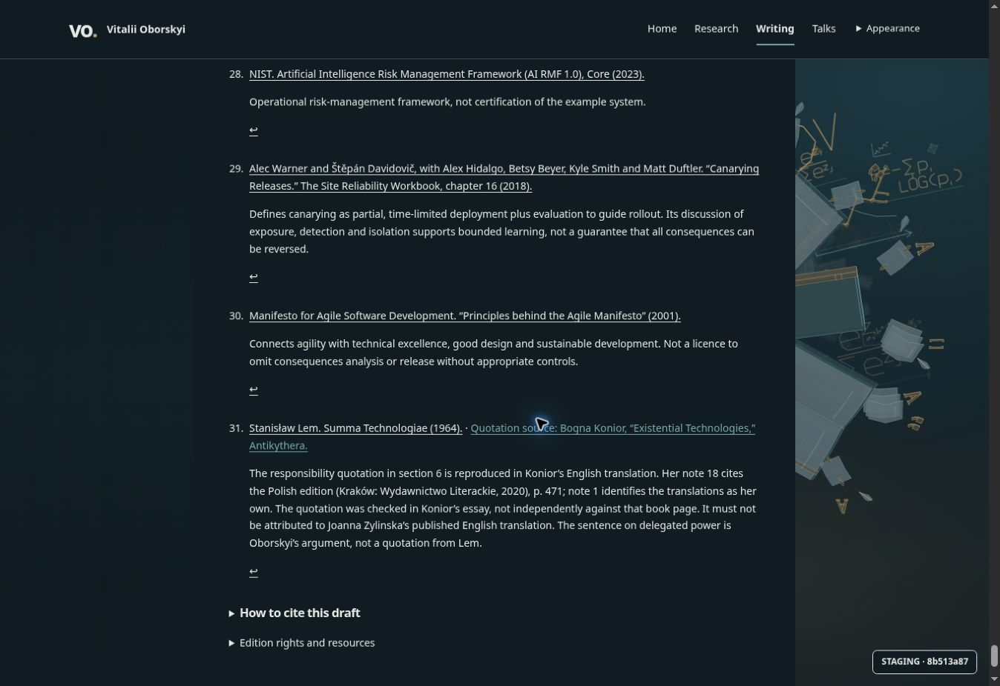
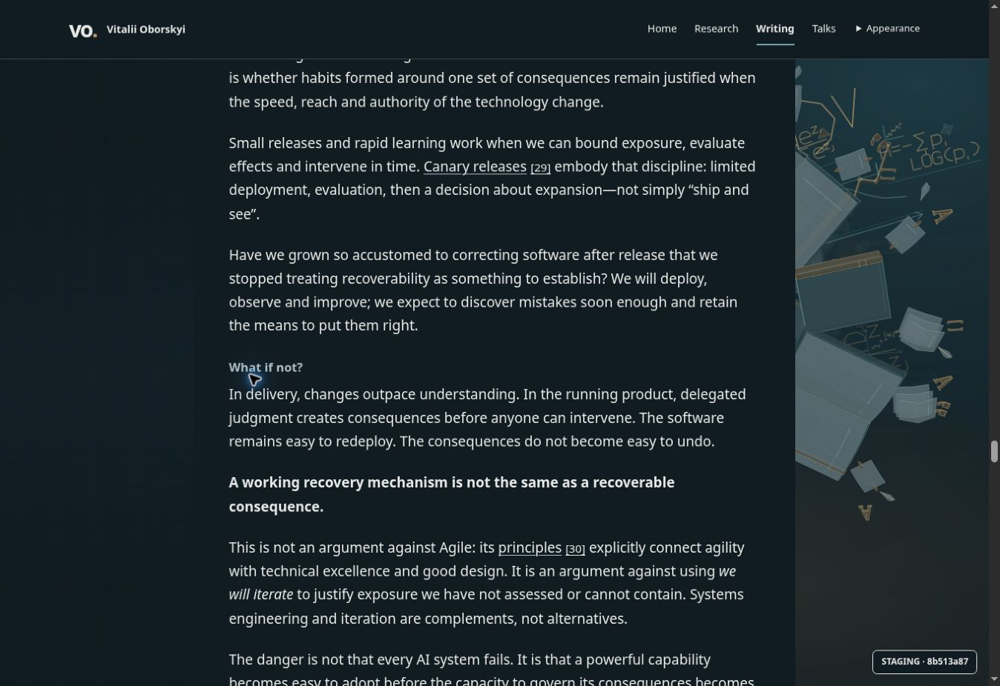
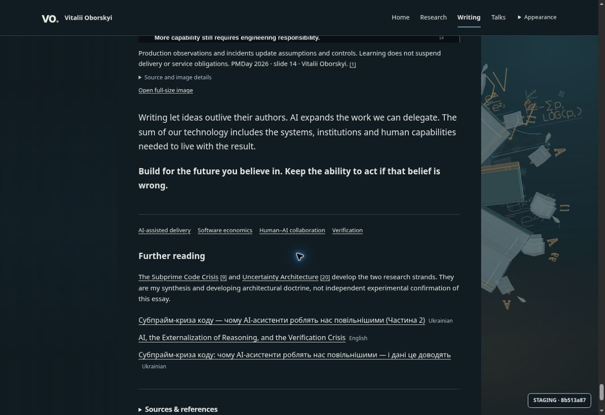

# Issue 5 — R13 correction and fresh Product Design reader audit

Owner: [issue 5, dated scope](https://github.com/oborskyivitalii/oborskyivitalii/issues/5#issue5-reader-audit-r13-20261019).
Execution: [Draft PR79](https://github.com/oborskyivitalii/oborskyivitalii/pull/79);
editorial/PDF/rights owner: issue 2.
Inspected base: `8b513a875d0c2c31d43bac994624e078999c3b1c`, tree
`374dbef19a5811e9354b45b32a6e0d150eacaf42`; implementation below is prepared state.

Primary role: editorial execution and live Product Design audit. Independent
bounded source/PDF review: `calm_reader_review`. Independent screenshot review:
`reader_product_audit`. These are agent reviews, not a human designer,
whole-PR, publication, physical-device or rights acceptance.

## Intent and authorized correction

The author reports that a previously selected edit still has not removed the
standalone **What if not?** inside chapter **6. What If Not?**. The visible
conversation memory preserves approval of the first proposed edit and rejection
of the second. Conversation retrieval failed to recover the exact old proposal;
this pass relies on the current explicit instruction, not invented recovered text.

The internal prompt becomes **The two shifts fail differently**. The following
consequences paragraph, chapter title, final acceptance-criterion sentence and
all other chapter refrains remain. Canonical/draft Markdown agree. R13 citation
labels and a new semantic edition identify this changed text; R12 edition and
exact PDF remain historical. Sources, numbers, image selection and media are unchanged.

Current source SHA256: `c9760da3dcc5003011777b7250d064a4232a0abea27505d3cedc057abf569d3f`.
Current semantic SHA256: `47aea976137c3dbb2f05addac576e9e0f7c1548a95572369243aeca9fd58a86e`.

The [R13 PDF](../issue-2/pmday-candidate-20261015/The_Sum_of_Our_Technology_R13_Cover02_Compact.pdf)
is a bounded text-operator correction of the retained R12 review PDF, not a
managed publisher export. The adjacent `r13-pdf-edit.py` reproduces its bounded
content operation. It preserves native extraction order, geometry and typeface
families. Two revised BibTeX lines re-embed DejaVu Sans Mono because the original
subset lacks digit 3; widths/origins remain equal, vertical bounds differ by
0.008 pt. Byte-identical reproduction across unpinned environments is unverified.

Independent PDF check: 15 pages, 19 bookmarks, all 132 link destinations and
rectangles, 8 image placements and vector drawings preserved. Per-page extracted
text differs only in the one prompt and 19 revision labels. At 144 dpi no pixels
changed outside those 20 text-span boxes. Pages 12/15 were also visually inspected.
PDF SHA256: `845641da117f45a9c448cc9a56a64805000790407e063d28fa6853947224e8ad`.
Earlier failed preparation attempts were diagnostics, not accepted outputs.

## Fresh audit scope and findings

Goal: read the essay, skim its structure, understand figures/table, verify a
source and return to the passage without losing context. The current dark
desktop preview was operated and captured anew in this audit; older screenshots
are not used as evidence. Source badge `8b513a87` identifies these captures.
The subsequent R13 change is prose/revision data only; it does not change reader UI.

Overall: the shared reading composition now works. The short outline, clear
chapter starts, isolated process, contained table and grouped ending do not
justify another layout redesign. Two supported improvements remain in the
source-verification path.

| ID | Evidence | Finding / effect | Proposal and priority | Disposition |
| --- | --- | --- | --- | --- |
| F01 | Step 4, source 29; DOM measurement | The return control is a standalone 14px arrow, about 11.7 × 19px. Its purpose is weak visually and aiming is unnecessarily precise. Its accessible name is descriptive and actual return works. | P1: visible “Return to passage”, generous click/focus area and a short target highlight. Keep native anchors and no-JS return. | Proposed, not implemented |
| F02 | Step 4, especially note 31 | Long annotations use much smaller type than essay prose over almost the same width; checking evidence is denser than reading the argument. | P2: slightly larger reference text/leading, restrained entry spacing; keep explanations, source links and returns together. Do not hide caveats to shorten the list. | Proposed, not implemented |
| F03 | Steps 2/3 | Core body line lengths and spacing are comfortable; process, quote and table each communicate their role. Bold/italic quotation styling is acceptable. | Keep the current foundation. Removing quote italics is an optional style preference, not a blocker. | No change selected |
| F04 | Steps 3/5 | Preview badge overlaps text near the bottom-right in some views. | Preview-shell concern; do not diagnose it as missing reader backing or claim screenshot-wide no-occlusion. | Disclosed limit |

Independent visual reviewer confirmed F01/F02 and found no new composition
blocker in Contents, chapter, table, process or quote captures. The primary
also exercised source 29 and its return: Sources opened and the native return
landed back at the cited passage. No temporary return highlight was visible.

## Captured flow

### 1. Entry and Contents — healthy

The closed control opens a short, single-level list of six chapters. It does
not compete with the article title or create a permanent sidebar. Body copy
and the article sheet remain visually consistent. No full keyboard audit is claimed.

### 2. Process and quotation — healthy

The SDLC chain reads as a separate figure; only code is emphasized. Its wrap
remains understandable. The quote is distinct from surrounding prose without
another card. No process/quote redesign is justified by these captures.

### 3. Chapter and decision table — healthy

The chapter start and separator provide a clear reading break. The table has
a continuous backing, aligned rows and legible column hierarchy. The screenshot
still shows the pre-correction prompt; the R13 editorial delta above fixes it.

### 4. Source check and return — works, needs refinement

Clicking reference 29 opens the source disclosure and lands at the note. The
descriptively named return anchor works, but the visible arrow is tiny and the
notes are dense. The return destination retains the reading passage; the screen
provides no conspicuous temporary indication of the exact citation.

### 5. Ending and discovery — healthy

The conclusion comes before tags and one coherent Further reading group.
Suggestions remain simple links. No duplicate recommendation heading or extra
card system is needed. The capture covers ending/discovery, not an exit journey.

## Evidence limits and next implementation

This fresh interactive audit is dark desktop. Mobile, light theme, zoom,
physical Safari/iPad, full keyboard focus order, assistive technology and
measured contrast are not established by these screenshots. The small arrow
is an observed interaction risk, not a blanket WCAG failure claim; exceptions
and adjacent-target geometry require their own check. Future hosted R13 smoke
and its current mobile images are separate evidence in PR79.

Recommended next increment: implement F01/F02 in the shared reader adapter/CSS,
preserving semantic links, native anchors, mobile wrapping and lifecycle. Do
not introduce another sidebar, article-specific layout or content rewrite.
Author has requested review/proposals here; that implementation is not selected yet.

## Acceptance and validation checkpoint

Related criteria: #2 AC01–AC03 editorial/PDF; #5 AC02/AC08/AC11/AC12 reader,
identity, review and preview. Original whole gates and checkbox states remain.
CS01/CS04/CS05/CS08/CS10 apply to source ownership, scoped evidence helper,
existing identity test and generated navigation. No runtime/template/style owner
changes; no formatter policy or new runtime dependency. The existing real-article
test advances its explicit current-edition pins, preserving original budgets,
rights checks and failure cases. No new duplicate test suite is added.

Prepared checkpoint: publisher validation and the focused article-media,
article-reader, reader-presentation and publishing-profile tests pass (19/19).
Independent exact bounded content/PDF review passes. Initial formatting attempt
correctly rejected the untracked new edition; source registration/staging and
the final current-source policy/hosted results are recorded in PR79 and the
owning issue, superseding this prepared-before-CI checkpoint.

No merge, production promotion, editorial/rights acceptance or external post is
implied by this source correction and audit.
