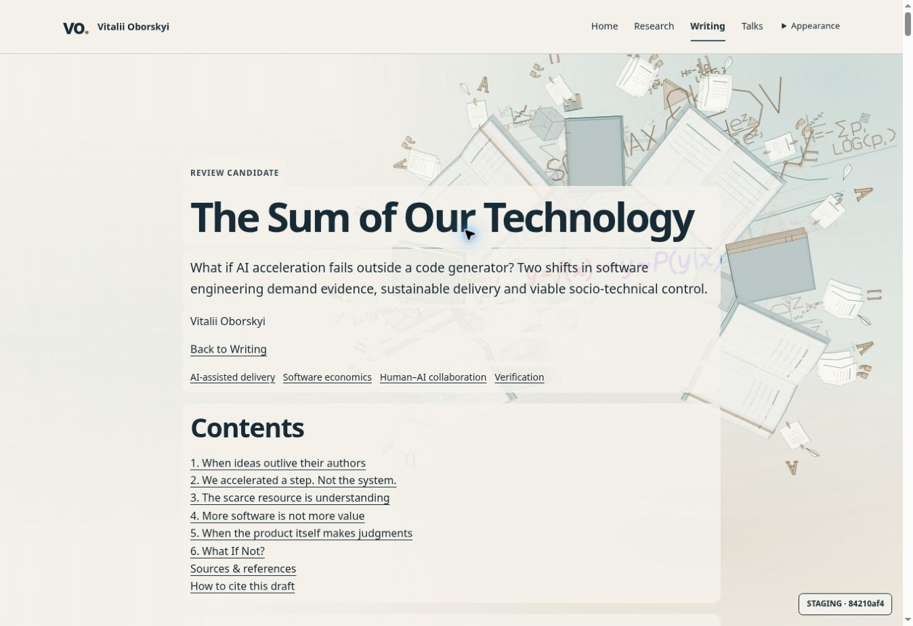
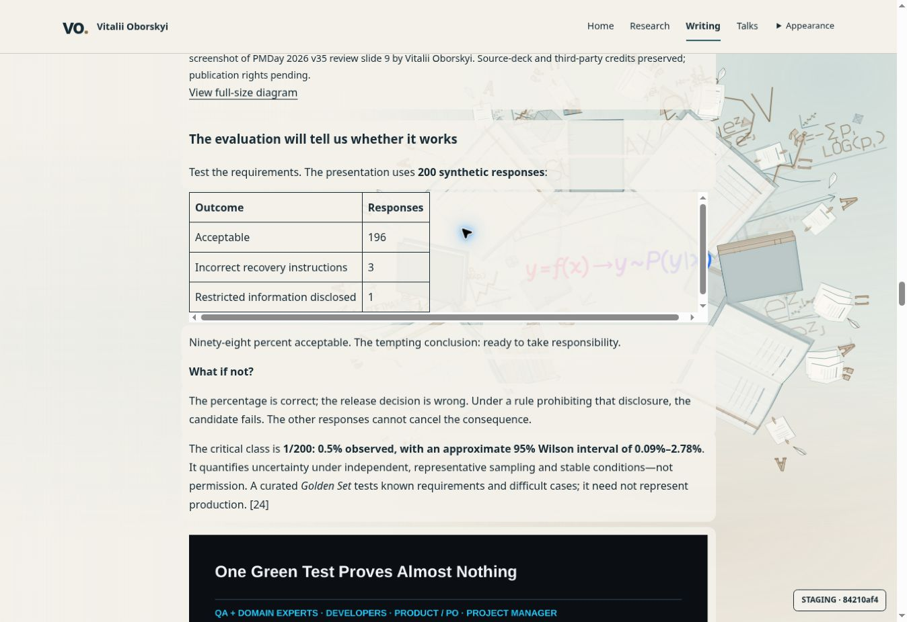

# Issue 5 — 2026-10-19 independent reader UX/UI review

Owning issue: [#5](https://github.com/oborskyivitalii/oborskyivitalii/issues/5),
dated anchor `issue5-reader-ux-ui-20261019`. Execution remains in
[Draft PR79](https://github.com/oborskyivitalii/oborskyivitalii/pull/79).

Inspected source: `84210af424ce960ca7809978515515dda1827ed1`,
tree `32e7716f101376b20df2d82cfeab5a52cceed1ad`.
[Exact deployed article](https://cf68ce14.oborskyi-author-ci-staging.pages.dev/articles/ai-changes-both-sides-of-software-engineering):
R12/Cover02, *The Sum of Our Technology*.

Review roles: the implementation agent performed a reader walkthrough and source
diagnosis; a separate `ux_reader_review` agent independently inspected the rendered
page before the source, without editing the implementation. The findings below
combine their observations. This is an independent AI heuristic review, not a
user study or an external human design sign-off.

## Intent, method and limits

The user explicitly requested an independent UX/UI review of awkward reading,
incomplete content backdrops, the table and the article structure. This pass
reviews the web presentation; it does not rewrite the manuscript or accept rights,
editorial claims, PDF or production publication. Existing AC02/AC08/AC11/AC12
and their human gates remain applicable and open.

Both reviewers inspected the live light-theme desktop page at a 1363 × 936 CSS-pixel
viewport: opening, long-form body, figures, both tables, sources, citation block
and ending. DOM/computed layout readings support the visual observations.
Canonical template, table renderer and reading-surface CSS were inspected after
the walkthrough. Root screenshots below are unchanged browser captures.

No mobile, physical iPad/Safari, dark-theme or assistive-technology visual review
was performed in this pass. Prior functional browser cases are separate evidence.
Worst-case text contrast was not measured. No reading-speed, comprehension or
conversion effect is asserted from this heuristic review.

## Verdict

**The current article is not ready for reader acceptance.** The reader inherits
the Writing landing page's decorative surface treatment without a coherent
long-form layout. The resulting interruptions are visible even when functional
navigation and asset checks pass. Fix the reading system before polishing the
fractal transition further.

P1 means fix before presenting the reader as ready; P2 means a substantial reading
improvement; P3 means secondary polish. These are review priorities, not newly
accepted issue criteria or formal accessibility conformance results.

## Findings

| ID / priority | Observed evidence | Reader impact and proposed treatment | AC impact / disposition |
| --- | --- | --- | --- |
| F01 / P1 | Both short tables display native horizontal **and vertical** scrollbars at desktop width. The first grid occupies about 361px inside a 780px block. Its client area is 765 × 181px, scroll area 777 × 193px. The decision grid occupies about 662px inside the same width. | A simple table looks broken and behaves like an embedded viewport. Keep semantic table layout; wrap only genuinely overflowing content. Give the table a complete surface, deliberate column widths, a quiet header and right-aligned numeric counts. These tables should need no vertical scroller. | AC02/08; open |
| F02 / P1 | The BibTeX block also has unnecessary two-axis scrolling: client 763 × 228px, scroll 775 × 240px. | The same decorative paint/overflow conflict affects a second component. Separate the paint container from the scrolling code area; allow horizontal scrolling only when the actual code requires it. | AC08; open |
| F03 / P1 | Paragraphs and headings form overlapping rounded translucent patches; tables show the scene through their cells. The independently inspected Related reading heading/list have no backdrop and sit directly on the book illustration. | The eye repeatedly changes between different reading conditions. Define a continuous article surface at a meaningful container level, including the related-reading area. Treat figures and tables as intentional components within it. | AC02/08; open |
| F04 / P1 | Books, equations and a bright formula remain visible behind text through the 87%-alpha paper treatment. | The brand illustration competes with sustained reading. Keep the same Writing fractal and the agreed orbit transition, but place the reading column on calm opaque paper. Let the scene remain visible in margins/opening; avoid movement underneath reading text. No contrast failure is claimed without measurement. | AC08/12; open |
| F05 / P2 | The first actual hook paragraph starts around document y=1405. A large top gap, title/deck, author/back link/tags and the full Contents block precede it. The actual software-engineering subtitle sits around y=930, below Contents. | The opening delays the argument and separates the subtitle from its title. Assemble one compact article header; bring the existing hook/thesis forward; put a compact contents control after the introduction or in a desktop rail. | AC02/08; open |
| F06 / P2 | Body text is 16px/28px over a 780px column; H2 is about 40px/48px while H3 is about 18.7px. Repeated bold prompts resemble subsection headings. | Dense prose has a long measure and small letters, with disproportionately large chapter breaks. Trial 18–20px body text over roughly 65–75 characters, then tune against actual paragraphs. Use a clear chapter/subsection/prompt hierarchy and consistent spacing. These are design starting points, not WCAG thresholds. | AC08; open |
| F07 / P2 | Cover/slide captions concatenate interpretation, slide numbers, author credit, producer/version details and pending-rights notes. The cover action says “View full-size diagram”. Full slides contain small embedded text at column width. | Build metadata interrupts the argument. Use a concise explanatory caption, then subordinate source/credit/rights details. Keep critical scientific limitations adjacent to the claim and all required notices accessible. Use accurate actions such as “Open cover image” and “Enlarge slide”; retain originals and an explicit full-size route. | AC02/06/08; open |
| F08 / P2 | Contents is static near the beginning. The long fifth chapter's six substantial subsections are not listed. | Resuming and locating a point in a long article is difficult. Offer a restrained “On this page” control or a desktop contents rail with current location and useful subsection links. Preserve native anchors, header offsets and keyboard/no-JS behavior. | AC08; open |
| F09 / P2 | Numbered citations such as `[3]` are text alongside named external links, rather than links to the article's 31 source notes. | Readers cannot efficiently move from a claim to its note and return. Make citation numbers navigate to stable reference IDs, with return links and visible focus. Keep the named external links and reference wording. | AC02/08; open |
| F10 / P3 | The ending contains 31 expanded annotated references, draft citation, raw BibTeX and rights before Related reading. Related items mix English and Ukrainian without language labels. The footer says “Keep scrolling for Talks ↓” but links to `?view=talks`. | The conclusion lacks a clean endpoint and secondary apparatus dominates. Establish an article ending, useful next reading and clearly labeled reference/citation/rights apparatus. Prefer same-language recommendations or label languages. Make the Talks destination explicit. No accidental-scroll navigation was reproduced in this pass. | AC08/12; open |

### Visual evidence

Opening: the argument and actual subtitle are below a full screen of front matter.

First table: short content inside a wide scrolling box; the background remains visible.

### Source diagnosis, separate from observation

`site/engine/styles.css` sets `.article-body table` to `display: block` and
`overflow-x: auto`. Its computed vertical overflow is also `auto`.
`site/engine/reading-surfaces.css` paints an absolutely positioned `::before`
with a negative 12px inset on direct article-body children, including tables
and `pre`. The observed 12px scroll overshoot strongly suggests this paint
contributes to the unwanted overflow. Confirm by isolating paint and scroll
ownership during the fix; do not treat that diagnosis as an already tested fix.

The same CSS owns 87% backdrop alpha and per-child patches. The template places
the full Contents before the body, where the manuscript subtitle and hook live.
The source of the presentation problem is therefore shared layout/adapter policy,
not a need to rewrite the author's argument.

## Proposed reading design

Keep the existing title, subtitle, cover, argument, evidence and six chapters.
The two-part argument is sound enough to preserve: delivery/system economics
in chapters 1–4, runtime judgment/control in chapter 5, closing decision in 6.
Make that hierarchy visible instead of flattening prose, slides and metadata
into a long sequence of equally treated blocks.

1. Compact Back to Writing, title plus its actual subtitle, one deck, author and
   concise edition/date metadata. Derive reading time only if introduced reliably.
2. Existing hook and two-shift thesis. Place the chosen cover deliberately with
   a short caption; keep the existing talk-resource links easy to find.
3. Compact Contents with useful chapter-5 subsections; preserve native access.
4. A stable reading column; figures/tables may break out wider when useful.
   Keep important uncertainty statements beside their claims.
5. Chapter 6 and its decision table as a clear conclusion, followed by useful
   next reading and explicit return navigation.
6. A clearly labeled research apparatus for the complete source notes,
   citation formats and edition/rights information. Native disclosures are an
   option, provided direct note targets, search, no-JS and print remain usable.

This is a proposed presentation order. It does not authorize silently moving
or deleting authored content, credits or substantive caveats. The layout should
support future articles without changing the five-scene navigation contract.

## Ordered implementation tasks

| Task | Owning paths and expected result | Findings / AC | Verification before acceptance | Status |
| --- | --- | --- | --- | --- |
| T01 | `site/engine/reading-surfaces.css`, `site/engine/styles.css`, `site/templates/pages/article.html`: one scoped article reading surface, complete related-reading treatment; existing palette/paint owners retained. | F03/04; AC08/12 | Visually inspect beginning, middle, ending and exposed margins in both themes; no distracting scene behind text, no gaps or unintended change to principal pages. Retain orbit/Off/reduced-motion/no-Canvas behavior. | proposed |
| T02 | Shared article table/code rendering in `tools/publishing/article.cjs`, `tools/site/articles.cjs` and canonical CSS: correct component/wrapper ownership. | F01/02; AC02/08 | Both real tables and citation block at desktop and narrow widths; no empty scrollbar, clipped paper or nested vertical scroll. Preserve headers/row relationships, all data and keyboard access. | proposed |
| T03 | Article template/CSS and bounded adapter metadata: compact header, correct subtitle placement, readable measure/type hierarchy, deliberate figure placement. | F05/06/07; AC02/08 | Read actual opening and chapters aloud/on screen; compare screenshots at desktop/narrow widths, zoom and both themes. Preserve manuscript/source/edition/media identity. | proposed |
| T04 | Shared adapter/template navigation and citation components: useful contents, navigable note references/backlinks, distinct appendix/credits, accurate media/link/language labels. | F07–10; AC02/08 | Claim→note→claim, keyboard, native anchors/deep refresh, no-JS/print; related reading remains useful and fully surfaced. Preserve source/rights text and destinations. | proposed |
| T05 | Applicable source/hosted profiles plus independent reader walkthrough on the corrected exact source; verify platform classification and budgets. | All; AC08/11/12 | Real article on desktop and mobile; actual Safari/iPad remains a named separate check. Inspect reading quality as well as automated functional results. | pending corrections |

Use CS01–CS10 through their existing owners if these tasks are implemented.
This pass changes documentation/catalog/memory only: CS01/05/08/10 apply to
ownership, format, proportional verification and honest evidence. No runtime,
template, manuscript, semantic edition or media change is made here.

## Acceptance evidence and remaining decisions

| Scope / AC | Result | Exact evidence | Remaining gate |
| --- | --- | --- | --- |
| Requested independent UX/UI assessment | Completed with the open findings above | Two separate live desktop walkthroughs of source `84210af4`; two original screenshots in this report | Findings have not been corrected or accepted |
| AC02/08 reader quality | Not accepted | F01–F10 on the deployed R12/Cover02 reader | Corrected preview and author/reader review |
| AC11 independence | Bounded independent UX pass completed; whole criterion remains open | Separate `ux_reader_review` inspection, source/scope/limits stated above | Whole-PR/required human/device gates |
| AC12 delivery | Existing Draft preview inspected; no production promotion | Existing run `39283194528` belongs to source `84210af4`; its functional passes do not establish this UX acceptance | Staging/publication/maintainer decisions remain separate |
| Review-document maintenance | Passed Basic 16/16 plus Color 10/10; bounded style guard; RI build/verify and 28 regressions; RI/CI verification and 20 regressions | Documentation-only prepared source; exact final tree/commit is recorded in PR79; no new hosted runtime matrix selected | These checks validate repository maintenance, not reading quality |

Accessibility acceptance for the correction should separately verify
[reflow](https://www.w3.org/WAI/WCAG22/Understanding/reflow.html),
[text resizing](https://www.w3.org/WAI/WCAG22/Understanding/resize-text.html) and
[text contrast](https://www.w3.org/WAI/WCAG22/Understanding/contrast-minimum.html).
Tables may legitimately require two-dimensional layout; their mere horizontal
scrolling is not automatically a reflow failure. The unnecessary desktop
scrollbars observed here are a specific component defect.

## Issue synopsis

19 October independent reader review of `84210af4` finds the R12 web presentation
unready for reader acceptance: unnecessary table/BibTeX scrollbars, fragmented
and missing backdrops, intrusive scene, delayed opening and weak reading
hierarchy. Ordered tasks T01–T05 define a coherent long-form reading treatment
without rewriting the article. Same Draft PR79; AC02/08/11/12 and publication
gates remain open. This review supersedes any reading-quality interpretation of
the earlier bounded functional/native implementation review.
